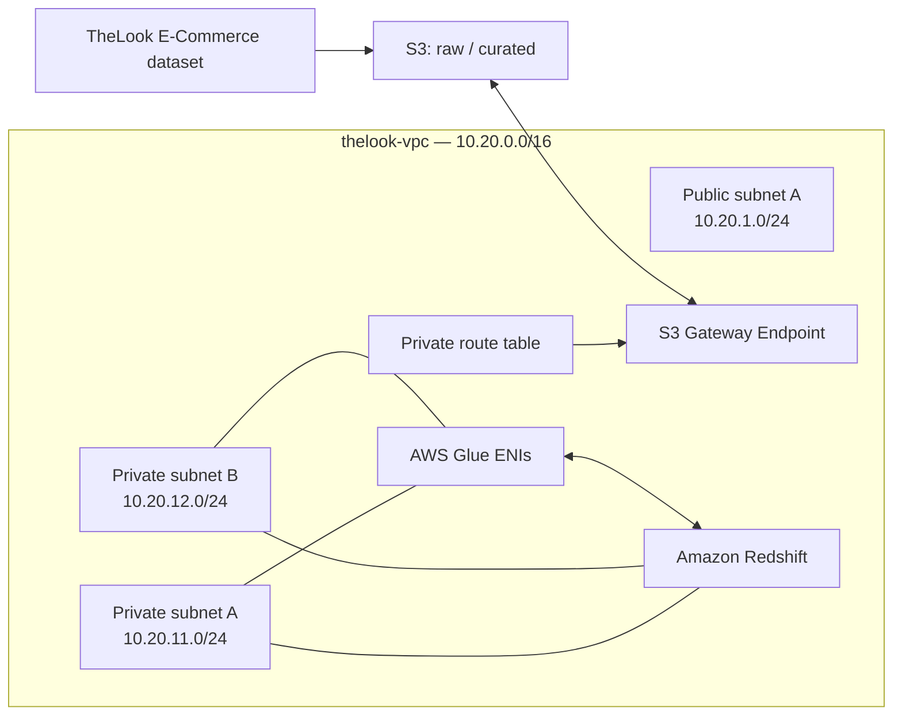

# Historical reference — superseded

Do not use as current deployment instructions. Read [current DW handoff](../dw_handoff.md). Original text preserved below; use current handoff for instructions.

# เอกสารส่งมอบงาน Cloud Infrastructure & Security ให้ทีม Data Warehouse

> เพิ่มบันทึก 23 ต.ค. 2026: เนื้อหาด้านล่างเก็บเป็น handoff เดิมวันที่ 16 ต.ค. ดู [สถานะ DW และ architecture ที่ใช้งานจริง](../dw_status_20261023.md) สำหรับงานที่ทำต่อแล้ว ปัจจุบัน Glue → Redshift validation และ NO_OP ผ่าน โดย cluster อยู่ default VPC และเข้าจาก thelook-vpc ผ่าน Redshift-managed endpoint ไม่ใช่ cluster อยู่ใน thelook-vpc ตามแผนเดิม

**โครงการ:** Cloud-Based E-Commerce Data Warehouse and Business Intelligence Platform (TheLook E-Commerce)  
**ภูมิภาค AWS:** US East (N. Virginia) — `us-east-1`  
**ปรับปรุงล่าสุด:** 16 ตุลาคม 2026  
**วัตถุประสงค์:** สรุปทรัพยากร AWS ที่สร้างและตรวจยืนยันจาก AWS Console พร้อมรายการตรวจสอบให้ทีม Data Warehouse ก่อนเริ่มสร้างส่วนคลังข้อมูล

> ขอบเขตของเอกสารนี้คือสถานะที่เห็นจากภาพ AWS Console และข้อมูลที่คุยกัน ไม่ได้ยืนยันสิทธิ์ IAM หรือทดสอบการเชื่อมต่อจริงทุกเส้นทาง รายการที่ระบุว่า “รอตรวจ” ต้องตรวจในบัญชี Lab ก่อนใช้งาน

## 1. สรุปสำหรับทีมรับช่วง

ได้เตรียมโครงข่ายพื้นฐานสำหรับรองรับงานคลังข้อมูลใน VPC แยก public subnet หนึ่ง subnet และ private subnet สอง subnet ข้ามสอง Availability Zones แล้ว มี Internet Gateway, route table แยก public/private, S3 Gateway VPC Endpoint และ security groups สำหรับ AWS Glue กับ Amazon Redshift

**ยังไม่มีการสร้างหรือรันคลังข้อมูลจริง** ได้แก่ S3 bucket, Redshift cluster/workgroup, Redshift subnet group, Glue database/crawler/connection/job, IAM role เฉพาะงาน, KMS customer-managed key และ CloudWatch alarms/log groups ที่กำหนดเอง ดังนั้นทีม DW ยังต้องตัดสินใจแบบข้อมูลและตรวจ Lab permissions/งบก่อนสร้างบริการเหล่านี้

แนวทางการไหลของข้อมูลที่เสนอ:

แผนภาพเป็นแบบที่ตั้งใจรองรับ ไม่ได้หมายความว่ามี Glue หรือ Redshift ทำงานอยู่แล้ว

## 2. ทรัพยากรที่สร้างและยืนยันจาก Console

### VPC และ subnet

| ทรัพยากร | ชื่อ / ID | ค่าและสถานะที่ยืนยัน |
|---|---|---|
| VPC | `thelook-vpc` / `vpc-03aaf81c62341e797` | `10.20.0.0/16`, Available, ไม่ใช่ Default VPC; DNS resolution และ DNS hostnames เปิดใช้งาน |
| Public subnet | `thelook-public-a` / `subnet-0ae903f04e29f7fca` | `10.20.1.0/24`, `us-east-1a`; auto-assign public IPv4 ปิด |
| Private subnet A | `thelook-private-a` / `subnet-0c93df663668db96` | `10.20.11.0/24`, `us-east-1a`; auto-assign public IPv4 ปิด |
| Private subnet B | `thelook-private-b` / `subnet-07441cbf39f0a9f33` | `10.20.12.0/24`, `us-east-1b`; auto-assign public IPv4 ปิด |

ชื่อ public/private บอกบทบาทที่ออกแบบไว้ เส้นทางจริงขึ้นกับ route table ที่ผูกกับ subnet ด้วย Public subnet นี้มีทางออกผ่าน IGW แต่ไม่ได้ auto-assign public IP ให้เครื่องที่จะสร้างภายหลัง

### Internet Gateway และ route tables

| ทรัพยากร | ID | เส้นทาง/association ที่ยืนยัน |
|---|---|---|
| Internet Gateway `thelook-igw` | `igw-0b52ef22d655f8d21` | Attached กับ `thelook-vpc` |
| Public route table `thelook-public-rt` | `rtb-0da93b957b00e87bd` | ผูกกับ `thelook-public-a`; `10.20.0.0/16 → local`, `0.0.0.0/0 → igw-0b52ef22d655f8d21` |
| Private route table `thelook-private-rt` | `rtb-074e7eeb21b5e9d0d` | ผูกกับ `thelook-private-a` และ `thelook-private-b`; `10.20.0.0/16 → local`, S3 prefix list `pl-63a5400a → vpce-09c521c76d4613f00`; **ไม่มี default route ไป NAT/IGW** |
| Main route table ของ VPC | `rtb-089df4f7bfd0ae179` | เห็น ID ใน VPC details; subnet ทั้งสามถูกผูกกับ route tables แบบระบุชัดแล้วตามภาพ association ล่าสุด |

### VPC Endpoint สำหรับ S3

- ชื่อ `thelook-s3-gateway`, ID `vpce-09c521c76d4613f00`
- ชนิด Gateway, บริการ `com.amazonaws.us-east-1.s3`, สถานะ Available
- ผูกกับ private route table ผ่าน managed prefix list
- Endpoint policy ตั้งเป็น Full access ตามขั้นตอนใน Console; policy นี้ **ไม่ได้แทน** IAM permissions หรือ S3 bucket policy
- S3 Gateway Endpoint ไม่มีค่าบริการ endpoint เพิ่มตามเอกสาร AWS แต่ S3 storage และ requests ยังคิดค่าบริการตามการใช้งาน

### Security groups

| Security group | ID | กฎที่ยืนยัน |
|---|---|---|
| `thelook-glue-sg` | `sg-0045646501501b218` | Inbound: All TCP จากตัว SG เอง (self-reference) สำหรับ Glue components; outbound: All TCP ไปตัวเอง, TCP 5439 ไป `thelook-redshift-sg`, TCP 443 ไป S3 managed prefix list `pl-63a5400a` |
| `thelook-redshift-sg` | `sg-0b074777ad7bd781a` | Inbound: Redshift TCP 5439 จาก `thelook-glue-sg`; outbound: HTTPS TCP 443 ไป S3 managed prefix list `pl-63a5400a` |

ไม่มี inbound จาก `0.0.0.0/0` ใน SG ของ Redshift และไม่มี outbound `0.0.0.0/0` ใน SG สองตัวนี้ตามภาพล่าสุด ตรวจ port 5439 อีกครั้งหากทีมเลือก port อื่นหรือรูปแบบ Redshift ต่างจากที่วางไว้

## 3. สิ่งที่ยังไม่ได้สร้าง / ยังไม่ยืนยัน

- S3 bucket สำหรับ raw, curated หรือ temporary data
- Amazon Redshift provisioned cluster หรือ Serverless workgroup/namespace และ subnet group
- AWS Glue database, crawler, connection และ ETL job
- IAM role เฉพาะงานหรือการผูก role เข้ากับ Redshift/Glue; ยังไม่ได้ตรวจ policy จริงของ `LabRole`
- Customer-managed KMS key, CloudWatch log group/alarm ที่กำหนดเอง, VPC Flow Logs
- NAT Gateway และ interface endpoints อื่น ๆ
- QuickSight: จากภาพมีข้อผิดพลาด `quicksight:DescribeAccountSubscription` ว่าไม่ได้รับอนุญาตใน Learner Lab จึงไม่ควรถือว่า QuickSight ใช้งานได้หรือเป็นเงื่อนไขของการเริ่ม DW
- ไม่มีการยืนยันว่าทดสอบ Glue เชื่อม Redshift หรืออ่าน/เขียน S3 สำเร็จแล้ว

หน้ารายละเอียด VPC เคยแสดง “Failed to load rule groups” สำหรับ Route 53 Resolver DNS Firewall rule groups ข้อความนี้อาจเกี่ยวกับสิทธิ์/การโหลดหน้าคอนโซล ไม่ได้ยืนยันว่ามี DNS Firewall ที่ผิดพลาด หากพบปัญหา DNS จริงให้ผู้ดูแล Lab ช่วยตรวจ

## 4. Checklist ก่อนทีม Data Warehouse เริ่มสร้างบริการ

[✔] ผ่านแล้ว,
[●] ตรวจบางส่วน,
[   ] ยังไม่เริ่ม

### A. ขอบเขตข้อมูลและแบบจำลอง

- [ ] ยืนยันชุดข้อมูลต้นทางและเวอร์ชันของ TheLook ที่จะใช้ พร้อมระบุว่าเป็นข้อมูลสังเคราะห์สำหรับโครงการ
- [ ] ตรวจ schema, ชนิดข้อมูล, primary/business keys, nulls, duplicate rows, ปริมาณข้อมูล และความถี่การโหลด
- [ ] ตกลงตาราง/โมเดลปลายทาง เช่น dimensions, facts, grain ของแต่ละ fact และวิธีจัดการข้อมูลซ้ำ/โหลดซ้ำ
- [ ] ตกลงการแบ่งชั้นข้อมูลและรูปแบบไฟล์: `raw`, `curated`/`processed`, และ prefix สำหรับไฟล์ชั่วคราวของ Redshift COPY/UNLOAD
- [ ] กำหนดวิธีตรวจผล: row counts, ตัวอย่าง query, reconciliation กับต้นทาง และเกณฑ์ยอมรับงาน

### B. S3 และเส้นทางเครือข่าย

- [ ] ตกลงชื่อ bucket ที่ไม่ซ้ำทั่วโลก, region `us-east-1`, owner, naming/prefix, lifecycle และ retention ก่อนสร้าง
- [ ] เลือกการเข้ารหัส bucket/object; S3 SSE-S3 เป็นทางเริ่มต้นที่เรียบง่าย ส่วน SSE-KMS ต้องตรวจสิทธิ์ key และต้นทุนก่อน
- [ ] ยืนยันว่า S3 bucket อยู่ region เดียวกับ endpoint และเลือก endpoint policy/bucket policy ที่จำกัดเท่าที่จำเป็น หลังทราบ bucket/role ARN
- [✔] ตรวจว่า private route table มี route ไป `pl-63a5400a` ผ่าน S3 endpoint และ endpoint state ยัง Available
- [●] ตรวจ DNS support/hostnames ของ VPC และการเชื่อมต่อ S3 จาก service ที่จะใช้ 
  > *"DNS support/hostnames เป็น true แล้ว แต่การเชื่อมต่อ S3 จริงรอทดสอบ"*
- [●] อย่าเพิ่ม NAT Gateway โดยอัตโนมัติ: เส้นทาง S3 ใน region เดียวมี Gateway Endpoint รองรับแล้ว แต่ให้ตรวจว่า Glue job ต้องเข้าถึงบริการ/แหล่งข้อมูลภายนอกหรือ endpoint อื่นเพิ่มหรือไม่ หากต้องใช้ NAT ให้คำนวณค่า hourly และ data processing ก่อน
  > *"ตอนนี้ไม่มี NAT Gateway แต่ยังไม่รู้ว่า Glue ต้องออกบริการภายนอกไหม"*

### C. Redshift

- [ ] ตัดสินใจว่าจะใช้ provisioned cluster หรือ Serverless โดยดูข้อจำกัดของ Learner Lab, วิธีหยุด/ลบ, workload และราคาใน `us-east-1`
- [ ] ยืนยันว่า permission ของ Lab อนุญาตสร้าง resource ที่เลือก และกำหนดผู้รับผิดชอบให้ชัดเจน
- [ ] หากใช้ provisioned cluster ให้สร้าง/ตรวจ subnet group โดยใช้ private subnet A และ B; ตรวจ AZ/subnet coverage และ SG
- [ ] ตั้ง cluster ให้ไม่ public และใช้ SG ที่จำกัด inbound เฉพาะ Glue SG/ผู้ทดสอบที่จำเป็น
- [ ] ตัดสินใจเรื่อง Enhanced VPC Routing; ถ้าเปิด ให้ทดสอบว่า COPY/UNLOAD ผ่าน S3 VPC endpoint ได้ตามที่คาด
- [●] ยืนยัน Redshift port; SG ที่เตรียมไว้เปิด TCP 5439 จาก Glue SG เท่านั้น
  >  "*ยืนยันพอร์ต 5439: ฝั่ง SG ผ่านแล้ว พอร์ตของ cluster ยืนยันตอนสร้าง*"
- [ ] ตกลงวิธี authentication และจัดการ secret โดยไม่ใส่รหัสผ่านในไฟล์, notebook, Git หรือภาพหน้าจอ
- [●] กำหนด IAM role ที่ Redshift ต้องใช้สำหรับ S3 COPY/UNLOAD และตรวจว่า Learner Lab อนุญาตให้ผูก `LabRole` ได้จริง
  >  "*IAM role สำหรับ COPY/UNLOAD: trust ของ LabRole มี redshift แต่ยังไม่ได้ทดสอบผูก*"

### D. Glue

- [ ] ตรวจว่า Learner Lab อนุญาต Glue connection/job ที่ต้องใช้และใช้ role ใดได้
- [●] เลือก private subnet สำหรับ Glue ENI และใช้ `thelook-glue-sg`; ตรวจ self-reference inbound ที่ Glue ต้องใช้และ egress ไป Redshift/S3 ตามภาพ
  >  "*Glue SG มี self-reference inbound แล้ว แต่ outbound ยังไม่ได้ตรวจ*"
- [ ] สร้าง Glue connection ไปยัง Redshift หลังมี endpoint/ฐานข้อมูลแล้ว และทดสอบ connection ก่อนเขียน ETL job
- [ ] กำหนด S3 temporary directory ให้ Redshift connector ใช้สำหรับ COPY/UNLOAD และให้สิทธิ์ S3 ที่จำเป็นกับ role
- [ ] ตรวจว่า Glue job ต้องเรียก AWS APIs อะไรระหว่างรัน หากต้องเรียกผ่าน VPC ให้ประเมิน interface endpoints หรือ NAT ตามความจำเป็นและงบ
- [ ] เริ่มจากข้อมูลปริมาณเล็กและ worker/concurrency ต่ำตามข้อจำกัด Lab; ทดสอบ log/error ก่อนรันข้อมูลเต็ม

### E. IAM, Security, Encryption และการติดตาม

- [●] ตรวจ policy/trust ของ `LabRole` และความสามารถในการส่ง role ให้ Glue/Redshift; อย่าสมมติว่าสร้าง custom IAM role ได้ เพราะ Learner Lab มักจำกัด IAM
  >  "*policy/trust ของ LabRole: trust มี redshift และ glue แต่ยังไม่ได้อ่านเนื้อหา policy*"
- [ ] แยกสิทธิ์ S3 read/write ตาม prefix และ service role เท่าที่ Lab อนุญาต; หลีกเลี่ยง wildcard ที่ไม่จำเป็น
- [●] ตรวจ SG IDs, port, source SG และ S3 prefix list หลังมีการสร้างบริการจริง
  >  "*SG ID, พอร์ต และต้นทางตรงกับเอกสาร แต่ต้องตรวจซ้ำหลังสร้างบริการจริง*"
- [ ] เลือกว่าจะใช้ AWS-owned key/SSE-S3 หรือ KMS customer-managed key; อย่าสร้าง CMK จนกว่าจะตรวจ permission, ค่าใช้จ่าย และการดูแล key
- [ ] วาง CloudWatch logs/metrics ที่จำเป็น เช่น Glue job failure และ Redshift load errors พร้อม retention ที่เหมาะกับงบ Lab
- [●] ไม่เปิดพอร์ต Redshift สู่ Internet และไม่ใส่ access key/secret ใน source code
  >  "*ไม่เปิดพอร์ต Redshift สู่ Internet: redshift SG ไม่มีกฎ inbound จาก 0.0.0.0/0 แต่ยังไม่มี cluster ให้ตรวจ*"

### F. งบประมาณและการอนุมัติ

- [ ] ตรวจยอด Learner Lab budget ที่เหลือและวันหมดอายุ/เงื่อนไขของ Lab ก่อนสร้างบริการคิดเงิน
- [ ] ทราบว่า meter ของ Lab อาจอัปเดตช้า ยอด `$0` ทันทีหลังสร้างไม่ใช่หลักฐานว่าไม่มีค่าใช้จ่าย
- [ ] ประเมินค่า Redshift ตามรูปแบบ/ขนาด/ชั่วโมงที่เปิด, Glue ตาม worker-hours, S3 ตาม storage/requests, CloudWatch ตาม logs/metrics และ NAT ตามชั่วโมง/ปริมาณข้อมูล
- [ ] ตั้งเวลาเปิดใช้งานและผู้รับผิดชอบปิด/ลบ resource หลังทดสอบ; การหยุด cluster อาจยังมีค่าเก็บข้อมูลหรือ snapshot ตามรูปแบบบริการ
- [ ] เริ่มสร้าง resource ที่คิดเงินเมื่อทีมตกลงขนาด, เวลาทดสอบ, แผนหยุด/ลบ และยอดงบที่รับได้แล้ว

## 5. ข้อมูลที่ทีม DW ควรส่งกลับให้ทีม Infrastructure

- [ ] ชื่อ bucket และ prefix ที่ต้องใช้ พร้อม region และ encryption choice
- [ ] บริการ Redshift ที่เลือก, subnet group/subnet IDs, port, public accessibility setting และเวลาที่คาดว่าจะเปิด
- [ ] Glue connection/job ต้องใช้ subnet/AZ, SG, S3 temporary path และ AWS API/service endpoints ใดบ้าง
- [ ] role ARN ที่ต้องใช้และ permission ที่จำเป็น (เพื่อเทียบกับข้อจำกัด Learner Lab)
- [ ] ผลทดสอบ connectivity และ COPY/UNLOAD/ETL พร้อม error ที่ไม่เปิดเผย secret
- [ ] รายงานค่าใช้จ่าย/การหยุดหรือลบ resource หลังทดสอบ

## 6. ประเด็นที่ยืนยันได้กับประเด็นที่เป็นข้อเสนอ

| สถานะ | รายการ |
|---|---|
| **ยืนยันจาก Console** | VPC, subnet 3 แห่ง, IGW, route tables/associations, S3 Gateway Endpoint และ security groups ตาม ID ในเอกสาร |
| **ออกแบบไว้แต่ยังไม่สร้าง** | S3 data lake, Redshift, Glue, IAM integration, KMS, CloudWatch monitoring และ data models |
| **ต้องให้ DW ตัดสินใจ** | bucket layout, schema, Redshift deployment mode/size, ETL design, encryption choice, retention และระยะเวลาทดสอบ |
| **ต้องตรวจใน Lab ก่อน** | IAM role/policies, Glue/Redshift permissions, available service quotas, pricing/budget, QuickSight access และความจำเป็นของ NAT/interface endpoints |

## 7. เอกสาร AWS อ้างอิง

- [Glue: เชื่อมต่อ Redshift และการใช้ S3 temporary directory](https://docs.aws.amazon.com/glue/latest/dg/aws-glue-programming-etl-connect-redshift-home.html)
- [Glue: ตั้งค่า network สำหรับการเชื่อมต่อ](https://docs.aws.amazon.com/glue/latest/dg/start-connecting.html)
- [Glue: S3 VPC Endpoint](https://docs.aws.amazon.com/glue/latest/dg/vpc-endpoints-s3.html)
- [S3 Gateway VPC Endpoint](https://docs.aws.amazon.com/vpc/latest/privatelink/vpc-endpoints-s3.html)
- [Redshift Enhanced VPC Routing และ VPC endpoints](https://docs.aws.amazon.com/redshift/latest/mgmt/enhanced-vpc-working-with-endpoints.html)
- [NAT Gateway pricing](https://docs.aws.amazon.com/vpc/latest/userguide/nat-gateway-pricing.html)
- [Amazon Redshift pricing](https://aws.amazon.com/redshift/pricing/)

---

**หมายเหตุส่งต่อ:** โครงข่ายพร้อมเป็นฐานสำหรับขั้นต่อไป แต่ยังไม่ควรเริ่มโหลดข้อมูลจริงจนกว่าจะผ่าน checklist เรื่อง Lab permissions, S3/IAM path, Redshift networking และงบประมาณก่อน

---
---

.

(checklist Infrastructure & Security  สิ่งที่ทำไปแล้วแมนนวล)

# คู่มือเช็กด้วยมือใน AWS Console: Infrastructure & Security โครงการ TheLook

คู่มือนี้พาตรวจด้วยมือทุกอย่างที่ทีม Infrastructure และ Security ระบุว่าสร้างไว้ใน `thelook-vpc` (us-east-1) 

## ก่อนเริ่ม

1. เข้า Learner Lab กด Start Lab รอจุดข้างคำว่า AWS เป็นสีเขียว แล้วกด AWS เพื่อเปิด Console
2. มุมขวาบนเลือก N. Virginia (us-east-1) ทุกหน้าต่อไปนี้ต้องอยู่ region นี้
3. พิมพ์ VPC ในช่องค้นหาด้านบนแล้วเปิดบริการ เมนูซ้ายของ VPC ใช้ในส่วน 1 ถึง 7
4. ค้นหา `thelook-vpc` ถ้าไม่เจอ แปลว่าบัญชีนี้ไม่ใช่บัญชีที่ทีม Infrastructure เตรียมไว้ ให้หยุดและถามทีมก่อน
5. ระหว่างตรวจ ห้ามกด Create, Edit, Delete หรือ Save ใดๆ ถ้าแท็บมีปุ่มแก้ ให้ดูอย่างเดียว

## 1. [✔] VPC

VPC ต้องชื่อ `thelook-vpc` และมีค่าตามตารางนี้ ไปที่ VPC > Your VPCs ค้นหาชื่อ แล้วคลิกเพื่อดูแท็บ Details

| ช่อง | ต้องเห็น |
| --- | --- |
| VPC ID | `vpc-03aaf81c62341e797` |
| State | Available |
| IPv4 CIDR | `10.20.0.0/16` |
| Default VPC | No |
| DNS resolution | Enabled |
| DNS hostnames | Enabled |
| Main route table | `rtb-089df4f7bfd0ae179` |

แท็บ DNS Firewall อาจขึ้น "Failed to load rule groups" เอกสารส่งมอบงานระบุว่าอาจเกี่ยวกับสิทธิ์หรือการโหลดหน้าของ Lab ไม่ได้ยืนยันว่ามีปัญหา DNS Firewall

## 2. [✔] Subnet

ต้องมี subnet สามอัน คนละบทบาท และ private สองอันอยู่คนละ AZ ไปที่ VPC > Subnets กรองด้วย `thelook` แล้วคลิกทีละอัน

| ชื่อ | Subnet ID | CIDR | AZ | Auto-assign public IPv4 |
| --- | --- | --- | --- | --- |
| `thelook-public-a` | `subnet-0ae903f04e29f7fca` | `10.20.1.0/24` | us-east-1a | No |
| `thelook-private-a` | `subnet-0c93df6636668db96` | `10.20.11.0/24` | us-east-1a | No |
| `thelook-private-b` | `subnet-07441cbf39f0a9f33` | `10.20.12.0/24` | us-east-1b | No |

ช่อง Auto-assign public IPv4 address อยู่ในแท็บ Details ส่วนแท็บ Route table ของแต่ละอันต้องตรงกับส่วน 4 ID ของ private-a เป็นค่าที่แก้แล้ว ฉบับเดิมของเอกสารส่งมอบงานขาดเลข 6 หนึ่งตัว

## 3. [✔] Internet Gateway

IGW ต้อง Attached กับ `thelook-vpc` ไปที่ VPC > Internet gateways แล้วค้นหา `thelook-igw`

| ช่อง | ต้องเห็น |
| --- | --- |
| ID | `igw-0b52ef22d655f8d21` |
| State | Attached |
| VPC ID | `thelook-vpc` |

## 4. [✔] Route table

Route table ฝั่ง private ต้องไม่มี `0.0.0.0/0` ไป IGW หรือ NAT ถ้ามี แปลว่า private subnet ไม่ private จริง ไปที่ VPC > Route tables กรองด้วย `thelook` คลิกทีละอัน แล้วดูแท็บ Routes และแท็บ Subnet associations (ส่วน Explicit subnet associations)

| Route table | Routes ที่ต้องเห็น | Subnet ที่ผูก |
| --- | --- | --- |
| `thelook-public-rt` `rtb-0da93b957b00e87bd` | `10.20.0.0/16` → local; `0.0.0.0/0` → `igw-0b52ef22d655f8d21` | `thelook-public-a` อย่างเดียว |
| `thelook-private-rt` `rtb-074e7eeb21b5e9d0d` | `10.20.0.0/16` → local; `pl-63a5400a` → `vpce-09c521c76d4613f00` (Active) | `thelook-private-a` และ `thelook-private-b` |
| Main `rtb-089df4f7bfd0ae179` | ควรมีแค่ local (ข้อแนะนำเพิ่ม ไม่ได้อยู่ในเอกสารส่งมอบงาน) | ไม่มี subnet ผูก |

ถ้า subnet ใดไม่ได้ผูกกับ route table แบบระบุชัด มันจะใช้ Main route table โดยอัตโนมัติ จึงควรเช็กว่าทั้งสามอันผูกครบตามตาราง

## 5. [✔] S3 Gateway Endpoint

Endpoint ต้อง available และผูกกับ route table ฝั่ง private ไปที่ VPC > Endpoints ค้นหา `thelook-s3-gateway` แล้วคลิกชื่อ

| แท็บ | ต้องเห็น |
| --- | --- |
| Details | ID `vpce-09c521c76d4613f00`; Type Gateway; Service name `com.amazonaws.us-east-1.s3`; Status Available |
| Route tables | `thelook-private-rt` (`rtb-074e7eeb21b5e9d0d`) |
| Policy | Full access |

เช็ก prefix list เพิ่มได้ที่ VPC > Managed prefix lists ค้นหา `pl-63a5400a` ชื่อควรเป็น `com.amazonaws.us-east-1.s3` นโยบาย Full access ของ endpoint ไม่ได้แทนสิทธิ์ IAM หรือ bucket policy

## 6. [✔] Security group

ทั้งสอง security group ต้องไม่มีกฎ `0.0.0.0/0` ทั้ง inbound และ outbound ไปที่ VPC > Security groups (หรือ EC2 > Security Groups) ค้นหา `thelook` แล้วเปิดแท็บ Inbound rules และ Outbound rules

| Security group | ID | Inbound ที่ต้องเห็น | Outbound ที่ต้องเห็น |
| --- | --- | --- | --- |
| `thelook-glue-sg` | `sg-0045646501501b218` | All TCP จาก `sg-0045646501501b218` (ตัวเอง) | All TCP ไปตัวเอง; TCP 5439 ไป `sg-0b074777ad7bd781a`; TCP 443 ไป `pl-63a5400a` |
| `thelook-redshift-sg` | `sg-0b074777ad7bd781a` | TCP 5439 จาก `sg-0045646501501b218` เท่านั้น | TCP 443 ไป `pl-63a5400a` |

ถ้าแท็บ Outbound rules มีกฎ All traffic ไป `0.0.0.0/0` แปลว่าไม่ตรงกับเอกสารส่งมอบงาน การตรวจ outbound ด้วยคำสั่งยังไม่ครอบคลุม จึงควรดูด้วยมือในหน้านี้

## 7. [✔] NAT Gateway

หน้า VPC > NAT gateways ต้องว่าง ไม่มี NAT ใน `thelook-vpc` NAT คิดเงินรายชั่วโมง ถ้าเจอรายการที่ไม่รู้ที่มา

## 8. [✔] ยืนยันว่ายังไม่ได้สร้างบริการ

เอกสารส่งมอบงานระบุว่ายังไม่มีบริการคลังข้อมูล ทุกหน้าในตารางนี้ต้องว่าง ถ้าพบของที่ไม่ตรง ให้แจ้งทีมก่อนสร้างอะไรทับ

| ไปที่ | ต้องเห็น |
| --- | --- |
| S3 > General purpose buckets | (0) |
| Redshift > Clusters, Serverless workgroups และ Configurations > Subnet groups | ไม่มีของ `thelook` |
| Glue > Databases, Crawlers, Connections, Jobs | ว่าง |
| KMS > Customer managed keys | ไม่มีคีย์ที่ทีมสร้าง (คีย์ใน AWS managed keys เป็นของ AWS ไม่นับ) |
| CloudWatch > Log groups และ Alarms | ไม่มีของ Glue หรือ Redshift ที่กำหนดเอง |
| VPC > Your VPCs > `thelook-vpc` > แท็บ Flow logs | ว่าง |

## 9. LabRole

เอกสารส่งมอบงานยังไม่ได้ตรวจสิทธิ์จริงของ `LabRole` ผลจากส่วนนี้จึงเป็นข้อมูลใหม่ที่ควรส่งกลับทีม ไปที่ IAM > Roles แล้วค้นหา `LabRole`

1. แท็บ Trust relationships: ใต้ Principal > Service ต้องมี `redshift.amazonaws.com` และ `glue.amazonaws.com` [✔]
2. แท็บ Permissions: เปิด policy ทีละอัน แล้วดูแท็บ JSON ว่ามี Allow สำหรับ `s3`, `redshift`, `glue` และ `iam:PassRole` หรือไม่

    | Policy | สิทธิ์ที่มี | เกี่ยวกับโครงการ |
    |---|---|---|
    | AmazonEC2ContainerRegistryReadOnly | `ecr:*` แบบอ่านอย่างเดียว | ไม่เกี่ยว |
    | AmazonEKSWorkerNodePolicy | `ec2:Describe*`, `eks:DescribeCluster` | ไม่เกี่ยว |
    | AmazonSSMManagedInstanceCore | `ssm`, `ssmmessages`, `ec2messages` | ไม่เกี่ยว |
    | AmazonEKSClusterPolicy | `ec2`, `elasticloadbalancing`, `autoscaling` | ไม่เกี่ยว |

    **สรุป**
    - ทั้งสี่ policy ไม่มี s3, redshift, glue หรือ `iam:PassRole`
    - ไม่มี `Deny` ในทั้งสี่ policy
    - ยังสรุปไม่ได้ว่า LabRole ใช้ S3, Redshift, Glue ได้หรือไม่ เพราะยังไม่ได้อ่าน VocLabPolicy1, 2, 3

3. หา statement ที่ Effect เป็น Deny เกี่ยวกับบริการเหล่านี้ เพราะ Deny ชนะ Allow เสมอ
4. ถ้า IAM ขึ้น access denied ให้ข้ามไป สิทธิ์จริงจะรู้ตอนลองสร้างบริการ

ตอนตรวจด้วยคำสั่ง ที่แนบอยู่คือ AmazonSSMManagedInstanceCore, AmazonEKSClusterPolicy, AmazonEC2ContainerRegistryReadOnly, AmazonEKSWorkerNodePolicy และ VocLabPolicy1 ถึง 3 ในชื่อเหล่านี้ไม่มี policy ของ S3, Redshift หรือ Glue โดยตรง จึงต้องอ่านเนื้อหาของ VocLabPolicy

## 10. งบและเวลาของ Lab

ที่หน้า Learner Lab ดูงบที่ใช้ไปและเวลาที่เหลือก่อนสร้างบริการที่คิดเงิน ยอด `$0` หลังสร้างบริการไม่ได้แปลว่าไม่มีค่าใช้จ่าย เพราะ meter อัปเดตช้า

## หมายเหตุ

- QuickSight ถูกบล็อกใน Lab ตามเอกสารส่งมอบงาน ไม่ต้องตรวจ
- ID ของ private-a ในเอกสารส่งมอบงานฉบับเดิมผิดไป 1 ตัวอักษร ส่วน 2 ใช้ค่าที่ถูกต้องแล้ว
- คู่มือนี้ตรวจแค่การตั้งค่าที่เห็นใน Console ไม่ได้แทนการทดสอบการเชื่อมต่อจริงของ Glue, Redshift และ S3 ซึ่งต้องทำหลังสร้างบริการ

