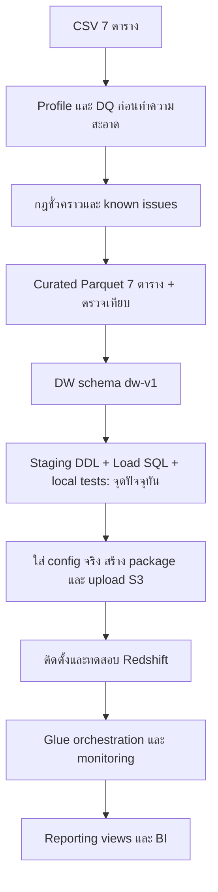

# Historical reference — superseded

Do not use as current deployment instructions. Read [current DW handoff](../dw_handoff.md). Original text preserved below; use current handoff for instructions.

# สถานะและ flow งาน Data Warehouse

## ล่าสุด 24 ต.ค. 2026

- ผู้ใช้ยืนยัน REPLAY_PASSED จาก CloudShell runner: ตรวจ S3 → Data API → 8ตาราง unchanged และ NO_OP เพิ่ม1 ผ่านแล้ว
- Reporting v1 ตามคำตอบผู้ใช้: แยกยอดตาม item status ยังไม่เรียก net sales; เตรียม8views/validation8checks/BI handoff/package, local relational fixture tests5ผ่าน ยังไม่ execute AWS
- Package: outputs/aws/reporting-v1.zip. ขั้นต่อไปผู้ใช้ติดตั้งใน thelook_glue_validation และส่ง validation results
- งานที่ยังไม่ปิด: source_observed_at ที่ยืนยัน, new-snapshot orchestration/schedule/alerts, BI permissions/dashboard และ inventory/events metrics ที่ต้องนิยามเพิ่มเติม ดู docs/new_snapshot_pipeline_contract.md

อัปเดต: 2026-10-23 • สถานะปัจจุบัน: **Glue ETL → Redshift isolated validation สำเร็จ และ NO_OP ผ่าน; cluster พักอยู่**

เพิ่มเติม 24 ต.ค.: Raw/curated Catalog metadata ผ่านครบ7ตาราง; ผู้ใช้ Resume และติดตั้ง thelook_scd_test ว่างครบ16ตารางแล้ว เตรียม outputs/aws/scd-test-fixtures-v1.zip และ local tests ผ่าน5รายการ ยังไม่รัน SCD/rollback บน AWS ให้ใช้สถานะล่าสุดนี้เหนือข้อความ cluster พักด้านบน

สถานะและ architecture ล่าสุด: [DW status 23 October](../dw_status_20261023.md) ขั้นที่เตรียมให้ทำต่อ: [Glue Data Catalog runbook](../glue_catalog_runbook.md)

หลักฐานล่าสุดจากผลที่ผู้ใช้รันบน AWS: batch `20261023T151247118967Z_f8a02155`, validation 66 checks PASS พร้อม known issues, staging 7 ตาราง, fact_sales 181,759 แถว; staging/warehouse sale_price ตรงกัน; การรันซ้ำได้ NO_OP และผลเทียบ 8 ตาราง PASS ไม่มีการตรวจ AWS live จากเครื่องนี้

งานค้าง: Crawler/Catalog, ยืนยันความหมายข้อมูลต้นทางและ observation time, SCD2/rollback tests, orchestration/monitoring, KPI/views และ BI handoff

## บันทึกเดิม ณ 18 ตุลาคม 2026

เนื้อหาด้านล่างเป็นประวัติก่อน deploy AWS; ให้ใช้เอกสารสถานะวันที่ 23 ตุลาคมด้านบนเป็นสถานะปัจจุบัน

ไฟล์นี้เป็นจุดติดตามงาน ให้แก้ checklist, หลักฐาน และประวัติท้ายไฟล์ทุกครั้งที่จบงานหรือพบ blocker ไม่ใช่ระบบติดตาม AWS อัตโนมัติ

โครงสร้างล่าสุด: โค้ดทั้งหมดอยู่ใน `code/`; เอกสารอยู่ใน `docs/` รวม `docs/report/`, `docs/workload.txt`, `docs/handoff1.md` ที่เก็บไว้ครบ ไม่ได้ลบ ส่วน dataset และ outputs อยู่ที่ project root ตามเดิม

ผลตรวจหลังจัดโฟลเดอร์: generate SQL สำเร็จ และ `python -m unittest discover -s code -v` ผ่าน **7 tests**; ยังไม่ได้ execute บน AWS

## Flow และตำแหน่งปัจจุบัน

## Checklist พร้อมหลักฐาน

| ขั้นตอน | สถานะ | สิ่งที่ทำ / หลักฐาน |
|---|---|---|
| Import/profile 7 ตาราง | เสร็จในเครื่อง | `code/project.ipynb` |
| Data dictionary, ความสัมพันธ์, cleaning rules | มีเอกสาร | `docs/dataset_dictionary_and_cleaning.md` |
| DQ ก่อน clean และวิเคราะห์ warning | เสร็จในเครื่อง | notebook, `code/dq_known_issues_baseline.json` |
| ยืนยันความหมาย city null และ item timestamps กับต้นทาง | **ยังค้าง** | กฎยังเป็น provisional-v1 ไม่ถือว่าได้รับการยืนยัน |
| Curated 7 ตาราง | ผ่านพร้อม known issues | batch `20261018T070120429459Z`; 52 checks PASS; quarantine 0 |
| DW schema precision/key/SCD | ระบุแล้ว | `docs/data_warehouse_schema_design.md` dw-v1 |
| Staging DDL 7 ตาราง | เขียนแล้ว | `code/sql/01_staging.sql` ตรงลำดับ Parquet |
| DW DDL 4 dimensions + 1 fact | เขียนแล้ว | `code/sql/02_warehouse.sql` |
| Ledger/COPY/load/SCD/reconciliation | เขียนแล้ว | `code/sql/00_control.sql`, `03_load_batch.sql`, `04_post_load_checks.sql` |
| Local contract tests | **4 tests PASS** | `code/test_warehouse_sql.py`, [ผลตรวจ](../report/warehouse_sql_local_validation.md); ไม่เท่ากับ execute SQL บน AWS |
| Package generator และ runbook | เขียนแล้ว | `code/prepare_aws_batch.py`, `code/aws_batch_config.example.json`, `code/sql/README.md` |
| ไฟล์สำหรับ Git repository | เตรียมแล้ว | `.gitignore`, `.gitattributes`, `README.md`, `code/requirements-dev.txt`, `dataset/README.md`; notebook ล้าง outputs แล้ว ยังไม่ init/commit/push |
| Bucket, IAM, Redshift, permissions/network | **รอตรวจบัญชีจริง** | handoff มีข้อมูลพื้นฐาน แต่ยังไม่ได้ตรวจ live ในงานนี้ |
| Upload batch และติดตั้ง SQL | **ยังไม่ได้ทำ** | ต้องกำหนด bucket/role จริงก่อน |
| Redshift integration/retry/SCD/rollback tests | **ยังไม่ได้ทำ** | checklist ใน `code/sql/README.md` |
| Glue database/crawler/job/schedule/monitoring | **ยังค้างตามสถาปัตยกรรม** | COPY ตรงไม่ต้องพึ่ง crawler แต่ยังไม่มี automated pipeline |
| นิยาม net sales/returns/cancellations และ reporting views | **ยังค้าง** | ห้ามตีความ SUM ทุกสถานะว่าเป็นยอดขายรับรู้ |
| BI, acceptance และ operational handoff | **ยังค้าง** | หลัง warehouse load และ metrics ผ่าน |

## ข้อมูลที่ใช้โหลดรอบแรก

ใช้เฉพาะ `outputs/curated/20261018T070120429459Z` ซึ่งมี validation_report.json กำกับ

| ตาราง staging | จำนวนแถว |
|---|---:|
| distribution_centers | 10 |
| products | 29,120 |
| users | 100,000 |
| orders | 125,226 |
| order_items | 181,759 |
| inventory_items | 490,705 |
| events | 2,431,963 |
| **รวม** | **3,358,783** |

DW round 1 ใช้ 4 dimensions + fact_sales (คาด 181,759 แถว) โดย events เก็บไว้ staging ยังไม่สร้าง fact_events จำนวน staging กับ DW จึงไม่จำเป็นต้องเท่ากัน

Known issues ที่ต้องคงข้อมูลเดิมและแฟล็ก: city token users 958, events 23,080; item shipped ก่อน created 35,872 จาก 118,281 แถวที่เปรียบเทียบได้ ห้ามรีเซ็ต baseline ให้ผ่านเมื่อจำนวนเปลี่ยนโดยไม่ตรวจเหตุผล

## ทำอะไรต่อ ตามลำดับ

1. ตรวจ AWS resources และสิทธิ์จากบัญชีจริง ระบุ S3 bucket/prefix และ Redshift IAM role
2. กรอก config และ generate manifests/package/upload script/run_batch.sql ตาม [คู่มือ SQL](../../code/sql/README.md)
3. ตรวจแล้ว upload batch ไป immutable prefix ตรวจขนาดและ hash หลัง upload
4. ติดตั้ง SQL 00–03 ใน Redshift ทดสอบ รัน batch และ SQL 04 เก็บผลตรวจ
5. ทดสอบ retry, SCD boundaries และ rollback ด้วย fixtures แยก ก่อนนำ pipeline ไป schedule
6. ทำ Glue/orchestration/logging/alert ตามสถาปัตยกรรมและตกลง metric กับผู้ใช้รายงาน

การถามต้นทางเรื่อง known issues ทำคู่ขนานได้ ระหว่างนี้ยังใช้กฎชั่วคราวที่ย้อนตรวจได้ ไม่ลบแถวหรือเติมเมือง และไม่ใช้ item.created_at คำนวณระยะเวลา

## ประวัติการทำงานและวิธีอัปเดต

### ผลตรวจเพิ่มเติม 2026-10-18: เลือก batch สำหรับ tests จากจุดเดียว

- `code/test_warehouse_sql.py` ใช้ `CURATED_TEST_BATCH` เลือก path ของ accepted batch; ค่าเริ่มต้นเป็น `20261018T121017059766Z`
- Package config ใช้ path เดียวกัน และคำนวณ observed_at จาก batch ID ในรายงาน ไม่ต้องแก้ AWS example config เพื่อรัน tests
- จำนวน fact ที่คาดหวังอิง order_items ของ batch ที่เลือก; รายงาน FAIL สร้างใน temporary fixture แทนการพึ่ง failed batch เก่า
- รัน `.venv/Scripts/python.exe -m unittest discover -s code -v` กับค่าเริ่มต้น batch ใหม่: **7 tests PASS** เป็นผลในเครื่อง ยังไม่ได้ทดสอบบน AWS

| วันที่ | งานที่ทำ | ผลและข้อจำกัด |
|---|---|---|
| 2026-10-18 | Curated และ schema dw-v1 | มี accepted batch และระบุ precision/key/SCD; ยังไม่ deploy |
| 2026-10-18 | เพิ่ม staging/control/DW DDL และ atomic load procedure | มี checks ก่อน publish, SCD2/Type1, full snapshot และ retry no-op; ต้องทดสอบ Redshift |
| 2026-10-18 | เพิ่ม package generator, local tests, runbook และไฟล์ flow นี้ | 4 tests PASS; bootstrap join 181,759 แถว เงินตรง; ไม่ได้ upload หรือเปลี่ยน AWS |
| 2026-10-18 | เตรียมไฟล์ขึ้น Git และล้าง notebook outputs 102 ส่วน | แยก data/output/local config/handoff/binary reports ออกจาก Git; เก็บ code และคำอธิบายเดิม ยังไม่ได้สร้าง remote หรือ push |

เมื่ออัปเดตให้ระบุ: ทำอะไร, ไฟล์/ผล query ที่เป็นหลักฐาน, test ผ่านหรือไม่, pending/blocker และขั้นตอนถัดไป แยกสถานะ “เขียนแล้ว”, “ทดสอบในเครื่องแล้ว”, “ทดสอบ AWS แล้ว” เสมอ ห้ามติ๊กงาน AWS เสร็จจากการมีไฟล์ SQL เพียงอย่างเดียว
