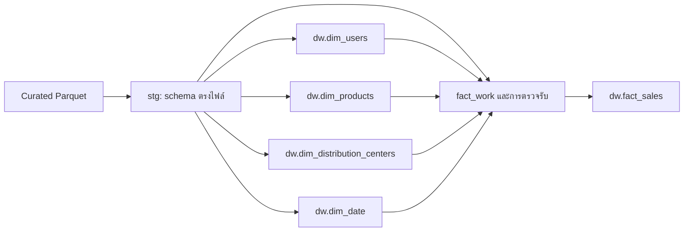

# Data Warehouse Schema — dw-v1

ปรับปรุง: 18 ตุลาคม 2026  
เป้าหมาย: Amazon Redshift — **1 fact (`fact_sales`) และ 4 dimensions**  
สถานะ: ข้อกำหนดสำหรับ implementation พร้อม DDL ฉบับปรับปรุง ยังไม่ได้รันใน AWS

ใช้ curated-v1 และกฎ provisional-v1 ที่มีอยู่ ไม่เปลี่ยน Parquet เดิม ข้อกำหนดการจัดเก็บในเอกสารนี้เป็นการตัดสินใจของโครงการ ส่วนความหมาย city/null และสาเหตุวันที่ item ผิดลำดับยังรอยืนยันต้นทาง

## 1. ข้อสรุปที่ใช้ในการพัฒนา

| เรื่อง | ข้อกำหนด |
|---|---|
| ขอบเขต | รายการสั่งซื้อและพฤติกรรมการซื้อ ไม่รวม clickstream/funnel ของ events ใน star schema นี้ |
| Grain | fact_sales หนึ่งแถวต่อ order_items.id เก็บทุกสถานะ quantity=1; ชุดปัจจุบันคาด 181,759 แถว |
| เงินจาก curated | DECIMAL(18,6) ไม่ปัดเหลือสองตำแหน่งตอนโหลด |
| ผลต่างเงิน | DECIMAL(19,6) รองรับผลลบ/บวกที่มีหลักเพิ่มขึ้น; การแสดงสองตำแหน่งทำใน BI |
| Natural keys | BIGINT; date_key เป็น INTEGER รูปแบบ YYYYMMDD |
| Surrogate keys | BIGINT IDENTITY(1,1) สำหรับ user/product/distribution center ไม่ใช้ MAX(key)+1 หรือเลขลำดับใน CSV |
| dim_users | SCD Type 2 เก็บการเปลี่ยนที่สังเกตได้หลังเริ่มโครงการ มี bootstrap snapshot สำหรับ facts เก่า |
| dim_products / dim_distribution_centers | Type 1 อัปเดต attribute โดยรักษา surrogate key |
| เวลา | TIMESTAMPTZ, UTC, microseconds; แปลงเป็น DATE ด้วย UTC เสมอ |
| วันที่ยังไม่เกิด | date FK เป็น NULL ใช้ LEFT JOIN ไม่สร้างวันที่สมมติหรือ sentinel -1 |
| Known issues | คงแฟล็กและ lineage; ไม่เขียนทับวันที่ item หรือ city ดิบ |
| โหลด | Parquet → staging → dimensions → fact_work → ตรวจรับ → publish |

## 2. เส้นทางข้อมูล



Staging ต้องตรงชนิดและลำดับคอลัมน์จริงของไฟล์ รวม flags: users 17, products 9, distribution_centers 4, orders 9, inventory_items 12, order_items 13 ส่วน events 15 คอลัมน์เก็บใน data lake/staging ได้ แต่ไม่ใช้สร้าง fact_sales รอบแรก ไม่ COPY ไฟล์เหล่านี้เข้า dim/fact โดยตรง

อ้างอิง [curated_schema.json](../code/curated_schema.json), [Data Dictionary](dataset_dictionary_and_cleaning.md), [ผลตรวจ curated](report/curated_validation.md)

## 3. Mapping dimensions

ชนิดและคอลัมน์ครบถ้วนอยู่ใน DDL ข้อ 7

### dim_users

| ปลายทาง | ที่มา / กฎ |
|---|---|
| user_key | IDENTITY สร้างเฉพาะ user ใหม่หรือ SCD version ใหม่ |
| user_id | users.id; หนึ่ง current version ต่อ user_id |
| full_name | first_name + ช่องว่างหนึ่งตัว + last_name; ตรวจ UTF-8 ไม่เกิน 1024 bytes |
| email, age, gender, state, country, postal_code, traffic_source | users ตามชื่อเดิม; postal_code เป็นข้อความ |
| age_group | 0–17 `<18`, 18–25 `18-25`, 26–35 `26-35`, 36–50 `36-50`, 51–120 `51+`; นอกช่วงให้ NULL พร้อม warning ไม่แก้ age |
| city | users.city_clean; city ดิบอยู่ staging/Parquet |
| city_missing_token | users.city_missing_token |
| valid_from, valid_to, is_current, version_origin, observed_at | ตามข้อ 5 |
| source_batch_id, rule_version | batch ที่สร้าง version และกฎที่ใช้ ไม่เปลี่ยนจากการ retry batch เดิม |

age/age_group เป็นค่าที่ snapshot ระบุ ไม่ใช่อายุจริง ณ วันซื้อย้อนหลัง และ traffic_source ของผู้ใช้ไม่ใช่ attribution ของทุก order โดยอัตโนมัติ

### dim_products

| ปลายทาง | ที่มา / กฎ |
|---|---|
| product_key | IDENTITY เฉพาะ product_id ใหม่ รักษาคีย์เดิมเมื่อ update Type 1 |
| product_id | products.id |
| product_name | products.name; NULL ได้ |
| category, brand, department, sku | products ตามชื่อเดิม; brand NULL ได้ |
| retail_price, cost | products แบบ DECIMAL(18,6); เป็นข้อมูลแค็ตตาล็อก ไม่ใช้แทนต้นทุน inventory รายชิ้นใน fact |
| source_batch_id, updated_at | batch/เวลาที่เปลี่ยน attributes ล่าสุด ถ้าไม่เปลี่ยนไม่ UPDATE |

### dim_distribution_centers

| ปลายทาง | ที่มา / กฎ |
|---|---|
| distribution_center_key | IDENTITY เฉพาะ natural key ใหม่ |
| distribution_center_id | distribution_centers.id |
| dc_name | distribution_centers.name |
| latitude, longitude | DOUBLE PRECISION เช่นเดียวกับ curated ไม่ปัดพิกัดเพิ่ม |
| source_batch_id, updated_at | แบบ Type 1 เช่น dim_products |

### dim_date

- สร้างวันต่อเนื่องจาก MIN ถึง MAX ของวันใน orders.created_at/shipped_at/delivered_at/returned_at ที่ไม่ว่าง โดยใช้ UTC ไม่จำกัดช่วงแค่ created_at
- date_key = ปี×10000 + เดือน×100 + วัน; full_date ต้องไม่ซ้ำ
- day_of_week แบบ ISO จันทร์=1 ถึงอาทิตย์=7; ชื่อวัน/เดือนภาษาอังกฤษ; weekend คือ 6–7
- เพิ่มเฉพาะวันที่ยังไม่มี ไม่ลบวันเดิม ไม่ใช้ ingestion date แทนวันที่ที่ขาด และไม่มี sentinel row

## 4. Mapping fact_sales

เริ่มจาก order_items i; join orders o ด้วย i.order_id=o.order_id และ inventory_items inv ด้วย i.inventory_item_id=inv.id ตรวจ i.user_id=o.user_id และ i.product_id=inv.product_id ก่อนเผยแพร่ ห้าม join inventory ด้วย product_id อย่างเดียว

| ปลายทาง | Mapping / ความหมาย |
|---|---|
| order_item_id | i.id; PK และ grain |
| order_id, inventory_item_id | i.order_id, i.inventory_item_id สำหรับ grouping/trace |
| user_key | lookup i.user_id กับ o.created_at ตาม SCD ข้อ 5 ต้องพบหนึ่ง version |
| product_key | lookup dim_products.product_id=i.product_id |
| distribution_center_key | lookup ด้วย inv.product_distribution_center_id; ใช้ศูนย์ของสินค้าชิ้นที่ขาย ไม่สลับกับ products.distribution_center_id |
| order_created_at, order_shipped_at, order_delivered_at, order_returned_at | o.created_at/shipped_at/delivered_at/returned_at; วันที่ item เดิมยังเก็บใน staging/Parquet |
| order_date_key | DATE(o.created_at AT TIME ZONE 'UTC') → dim_date; ห้ามว่าง |
| shipped_date_key, delivered_date_key, returned_date_key | วันที่ UTC ของ timestamp ระดับ order ที่เกี่ยวข้อง; timestamp NULL → key NULL |
| status | i.status ไม่เขียนทับด้วยสถานะ order |
| quantity | 1; ห้ามใส่ orders.num_of_item ซ้ำทุกแถว |
| sale_price | i.sale_price; ราคาของรายการ ไม่เรียกว่า net revenue ที่หักคืน/ยกเลิกแล้ว |
| product_cost | inv.cost; ต้นทุนชิ้นที่อ้างถึง |
| reference_retail_price | inv.product_retail_price; เก็บค่าอ้างอิงใน fact เพื่อไม่เปลี่ยนตาม Type 1 ของ product |
| gross_profit | CAST(sale_price - product_cost AS DECIMAL(19,6)); ผลต่างเชิงเลข ไม่ใช่ realized profit ทุกสถานะ |
| catalog_price_difference | CAST(reference_retail_price - sale_price AS DECIMAL(19,6)); ไม่รับรองว่าเป็นส่วนลดธุรกรรมจริง |
| discount_amount | NULL ใน dw-v1 เพราะไม่มีหลักฐานยอดส่วนลดธุรกรรม ไม่แทนด้วย 0 หรือผลต่างราคาโดยเงียบ |
| shipping_duration_days | elapsed days จาก **order.shipped_at → order.delivered_at** คำนวณ microseconds / 86,400,000,000 แล้ว HALF_UP เป็น 6 ตำแหน่ง ไม่ใช่นับเส้นแบ่งวัน |
| item_shipped_before_created, item_dates_comparable | flags จาก i ตาม provisional-v1; แฟล็กแรก NULL ได้ |
| source_batch_id, rule_version, loaded_at | lineage ของ snapshot ที่เผยแพร่; loaded_at ใช้ค่าคงเดิมหนึ่งค่าต่อ batch |

คำนวณ shipping_duration_days เมื่อมีวันส่ง/รับครบและ delivered_at ≥ shipped_at เท่านั้น วันไม่ครบให้ NULL; ผิดลำดับให้ NULL พร้อมบันทึก warning ห้ามใช้ order_items.created_at ในสูตรระยะเวลา

ระยะเวลาเป็น **non-additive** ระดับ order ที่ซ้ำตามจำนวน items หากต้องการค่าเฉลี่ยแบบแต่ละ order มีน้ำหนักเท่ากัน ต้องเลือกหนึ่งแถวต่อ order ก่อน ไม่เฉลี่ยตรงจากทุก fact row

ทุกสถานะยังอยู่ใน fact; reporting views ต้องระบุ status/วันที่และกฎ Returned/Cancelled ก่อนใช้คำว่ายอดขายสุทธิหรือกำไรรับรู้ การนับ orders ใช้ COUNT(DISTINCT order_id)

## 5. Bootstrap และ SCD Type 2

### 5.1 Snapshot แรก

ไม่มีประวัติลูกค้าจริงย้อนหลัง ใช้ **open-start bootstrap snapshot** ดังนี้:

1. สร้างหนึ่ง version ต่อ users.id จาก attributes ที่พบใน snapshot
2. valid_from=NULL หมายถึงขอบล่างไม่ทราบเฉพาะ bootstrap ไม่ใช่วันที่ลงทะเบียนหรือวันที่เริ่มมีผลจริง
3. valid_to=NULL, is_current=true, version_origin='BOOTSTRAP_SNAPSHOT'; observed_at=T เป็นเวลารับ snapshot แรกใน UTC
4. historical facts ของผู้ใช้ใน snapshot ผูกกับ version นี้ การวิเคราะห์การซื้อเก่าตามเมือง/อายุจึงใช้ attributes ที่สังเกตใน snapshot ไม่ใช่ as-of history จริง ต้องระบุข้อจำกัดนี้
5. บันทึก T, batch ID และ rule version คงเดิมเมื่อ retry ไม่ตั้ง CURRENT_TIMESTAMP ใหม่ทุกครั้ง

### 5.2 Snapshot ถัดไป

- เปรียบเทียบ current version แบบ null-safe ของ full_name, email, age, gender, city, city_missing_token, state, country, postal_code, traffic_source; age_group เป็น derived field
- ไม่เปลี่ยน → ไม่เพิ่ม version และรักษา user_key
- เปลี่ยน → ปิด version เดิมด้วย valid_to=T, is_current=false แล้วสร้าง version ใหม่ valid_from=T, valid_to=NULL, is_current=true, version_origin='OBSERVED_CHANGE'
- ผู้ใช้ใหม่หลัง bootstrap → valid_from=T และ version_origin='OBSERVED_NEW' ไม่กำหนดขอบล่าง NULL อัตโนมัติ
- ช่วงเวลาเป็น [valid_from, valid_to); T คือเวลาที่สังเกตการเปลี่ยน ไม่ใช่ source effective timestamp ที่พิสูจน์แล้ว
- ผู้ใช้หายจาก snapshot → ไม่ตีความว่า delete และไม่ปิด version จนกว่าจะมี deletion rule
- ถ้ากฎ city เปลี่ยนจากคำยืนยันต้นทาง ให้จัดการเป็น correction พร้อม rule version ไม่ถือเป็นการย้ายเมืองจริงอัตโนมัติ

### 5.3 Lookup และ late-arriving fact

```sql
JOIN dw.dim_users u
  ON u.user_id = i.user_id
 AND (u.valid_from IS NULL OR o.created_at >= u.valid_from)
 AND (u.valid_to IS NULL OR o.created_at < u.valid_to)
```

ก่อน inner join ต้องตรวจจำนวน matches ต่อ item เท่ากับหนึ่ง ถ้าไม่พบ/พบหลาย version ให้พักเพื่อทบทวน ไม่ให้ fact หายหรือเพิ่มแถวเงียบ ๆ ผู้ใช้ใหม่หลัง bootstrap ที่มี late fact ก่อน valid_from ต้อง review ไม่ fallback ไป current version โดยเดา

อนุญาต valid_from=NULL เฉพาะ version แรกที่ version_origin='BOOTSTRAP_SNAPSHOT'; เมื่อปิด version นี้คง valid_from=NULL และ valid_to=T ของ version ถัดไป ช่วงเวลาต้องไม่ซ้อน และแต่ละ user มี current หนึ่งแถว

## 6. Keys และ idempotent loading

- INSERT dimensions โดยไม่ระบุ identity key ไม่คาดว่าเลขต่อเนื่องหรือเท่ากันเมื่อ rebuild ฐานข้อมูลใหม่
- ETL บังคับ product_id/DC id ไม่ซ้ำ และหนึ่ง current version ต่อ user_id โหลด dimensions ก่อน fact และ lookup ด้วย natural keys
- ใช้ผู้เขียนหนึ่งงานต่อชุดตารางในเวลาเดียวกัน ไม่สร้าง key/version แข่งกัน
- มี batch ledger ใน control schema เก็บ batch_id, hashes, schema/rule versions, T, status; เป็นตารางควบคุม ไม่เพิ่ม business fact/dimension เกิน 1+4
- batch ที่สำเร็จแล้วและ input/rules เหมือนเดิมเป็น no-op; input/rule เปลี่ยนต้องเป็น batch/version ใหม่
- ห้าม TRUNCATE/reseed dimensions ทุกครั้ง เพราะทำลายคีย์และ SCD history
- full snapshot: เตรียม staging; ภายใน transaction สร้าง/อัปเดต dimensions และ fact_work, ตรวจรับ แล้วแทน fact snapshot ด้วย DELETE+INSERT ก่อน commit ถ้าผิดให้ rollback ทั้ง dimension และ fact
- ไม่ใช้ TRUNCATE ใน publish ที่ต้อง rollback; เก็บสถานะ FAILED ใน ledger หลัง rollback ด้วยขั้นตอนควบคุมแยก
- Implementation ของ ledger/transaction/load SQL อยู่ใน `sql/00_control.sql` และ `sql/03_load_batch.sql` แล้ว; ยังต้องทดสอบ transaction/retry/SCD บน Redshift จริง

## 7. DDL สำหรับสร้าง warehouse ใหม่ครั้งแรก

ถ้ามีตารางเดิมให้ใช้ migration ไม่ DROP อัตโนมัติ Staging/COPY/load SQL อยู่ในโฟลเดอร์ `sql/` ดูลำดับติดตั้งใน `sql/README.md`

```sql
CREATE SCHEMA IF NOT EXISTS dw;
SET timezone TO 'UTC';

CREATE TABLE dw.dim_date (
    date_key INTEGER NOT NULL PRIMARY KEY,
    full_date DATE NOT NULL,
    day_of_week SMALLINT NOT NULL,
    day_name VARCHAR(10) NOT NULL,
    day_of_month SMALLINT NOT NULL,
    month SMALLINT NOT NULL,
    month_name VARCHAR(10) NOT NULL,
    quarter SMALLINT NOT NULL,
    year INTEGER NOT NULL,
    is_weekend BOOLEAN NOT NULL
) DISTSTYLE AUTO SORTKEY AUTO ENCODE AUTO;

CREATE TABLE dw.dim_users (
    user_key BIGINT IDENTITY(1,1) NOT NULL PRIMARY KEY,
    user_id BIGINT NOT NULL,
    full_name VARCHAR(1024) NOT NULL,
    email VARCHAR(512) NOT NULL,
    age SMALLINT NOT NULL,
    age_group VARCHAR(20),
    gender VARCHAR(32) NOT NULL,
    city VARCHAR(256),
    city_missing_token BOOLEAN NOT NULL,
    state VARCHAR(256) NOT NULL,
    country VARCHAR(128) NOT NULL,
    postal_code VARCHAR(32) NOT NULL,
    traffic_source VARCHAR(64) NOT NULL,
    valid_from TIMESTAMPTZ,
    valid_to TIMESTAMPTZ,
    is_current BOOLEAN NOT NULL,
    version_origin VARCHAR(32) NOT NULL,
    observed_at TIMESTAMPTZ NOT NULL,
    source_batch_id VARCHAR(64) NOT NULL,
    rule_version VARCHAR(64) NOT NULL
) DISTSTYLE AUTO SORTKEY AUTO ENCODE AUTO;

CREATE TABLE dw.dim_products (
    product_key BIGINT IDENTITY(1,1) NOT NULL PRIMARY KEY,
    product_id BIGINT NOT NULL,
    product_name VARCHAR(1024),
    category VARCHAR(128) NOT NULL,
    brand VARCHAR(256),
    department VARCHAR(32) NOT NULL,
    sku VARCHAR(128) NOT NULL,
    retail_price DECIMAL(18,6) NOT NULL,
    cost DECIMAL(18,6) NOT NULL,
    source_batch_id VARCHAR(64) NOT NULL,
    updated_at TIMESTAMPTZ NOT NULL
) DISTSTYLE AUTO SORTKEY AUTO ENCODE AUTO;

CREATE TABLE dw.dim_distribution_centers (
    distribution_center_key BIGINT IDENTITY(1,1) NOT NULL PRIMARY KEY,
    distribution_center_id BIGINT NOT NULL,
    dc_name VARCHAR(256) NOT NULL,
    latitude DOUBLE PRECISION NOT NULL,
    longitude DOUBLE PRECISION NOT NULL,
    source_batch_id VARCHAR(64) NOT NULL,
    updated_at TIMESTAMPTZ NOT NULL
) DISTSTYLE AUTO SORTKEY AUTO ENCODE AUTO;

CREATE TABLE dw.fact_sales (
    order_item_id BIGINT NOT NULL PRIMARY KEY,
    order_id BIGINT NOT NULL,
    inventory_item_id BIGINT NOT NULL,
    user_key BIGINT NOT NULL REFERENCES dw.dim_users(user_key),
    product_key BIGINT NOT NULL REFERENCES dw.dim_products(product_key),
    distribution_center_key BIGINT NOT NULL REFERENCES dw.dim_distribution_centers(distribution_center_key),
    order_created_at TIMESTAMPTZ NOT NULL,
    order_shipped_at TIMESTAMPTZ,
    order_delivered_at TIMESTAMPTZ,
    order_returned_at TIMESTAMPTZ,
    order_date_key INTEGER NOT NULL REFERENCES dw.dim_date(date_key),
    shipped_date_key INTEGER REFERENCES dw.dim_date(date_key),
    delivered_date_key INTEGER REFERENCES dw.dim_date(date_key),
    returned_date_key INTEGER REFERENCES dw.dim_date(date_key),
    status VARCHAR(32) NOT NULL,
    quantity INTEGER NOT NULL,
    sale_price DECIMAL(18,6) NOT NULL,
    product_cost DECIMAL(18,6) NOT NULL,
    reference_retail_price DECIMAL(18,6) NOT NULL,
    gross_profit DECIMAL(19,6) NOT NULL,
    catalog_price_difference DECIMAL(19,6) NOT NULL,
    discount_amount DECIMAL(19,6),
    shipping_duration_days DECIMAL(18,6),
    item_shipped_before_created BOOLEAN,
    item_dates_comparable BOOLEAN NOT NULL,
    source_batch_id VARCHAR(64) NOT NULL,
    rule_version VARCHAR(64) NOT NULL,
    loaded_at TIMESTAMPTZ NOT NULL
) DISTSTYLE AUTO SORTKEY AUTO ENCODE AUTO;
```

## 8. เกณฑ์ตรวจรับ

1. ตรวจ staging schema และ baseline ก่อนโหลด Bootstrap คาด users 100,000, products 29,120, DC 10 แถว; dim_date ขึ้นกับช่วงวันจริง
2. PK ทั้ง 5 ตารางไม่ว่าง/ซ้ำ; natural key product/DC ไม่ซ้ำ; current user หนึ่งแถวต่อ user_id
3. SCD ช่วงไม่ซ้อน, valid_from NULL เฉพาะ bootstrap แรก, current iff valid_to NULL, valid_to>valid_from เมื่อทั้งคู่มีค่า
4. Lookup ได้หนึ่งแถวต่อ item รวม fact 181,759 แถว และ non-null FK พบคู่ครบ
5. quantity=1; distinct orders และจำนวน item ต่อ order ตรง staging
6. SUM(sale_price), product_cost และ reference_retail_price ตรง staging ที่ join inventory_item_id แบบ exact; ผลต่าง DECIMAL(19,6) ตรงสูตร ไม่มี rounding สองตำแหน่งเพิ่ม
7. date keys/NULL/UTC และ flags ตรง mapping; discount_amount ทุกแถว NULL จนกว่าจะมีกฎที่มีหลักฐานรองรับ
8. ทดสอบรัน batch เดิมเป็น no-op, user ไม่เปลี่ยนไม่เพิ่ม version, เปลี่ยน attribute เพิ่มหนึ่ง version และปิดของเดิม, fact ณ boundary T เลือกรุ่นใหม่
9. ทดสอบ rollback กลางการโหลดและ late-arriving fact ที่ lookup ไม่ได้เข้าสถานะ review

## 9. ข้อกำหนด Redshift และงานถัดไป

- เริ่มด้วย DISTSTYLE AUTO / SORTKEY AUTO / ENCODE AUTO แล้ววัด workload จริง ไม่สร้าง secondary index หรือ range/list partition บน internal fact table
- PK/FK/UNIQUE เป็น informational constraints และ optimizer ใช้ข้อมูลนี้ จึงต้องมี SQL checks จริงก่อน publish
- IDENTITY ไม่ได้แก้ uniqueness/idempotency ให้ ETL ทั้งหมด; ไม่มี DEFAULT CURRENT_TIMESTAMP ใน valid_from เพราะต้องใช้กฎ bootstrap/observed time
- มี staging DDL, COPY, load SQL, ledger/transaction และ validation SQL จากแบบนี้แล้วใน `sql/`; ยังไม่ได้ execute ในบัญชี AWS จริง ดูสถานะและ checklist ที่ `WORK_PROGRESS.md`
- Known issues ยังรอยืนยัน และนิยาม net sales/realized profit สำหรับ BI ยังต้องตกลงตามโจทย์รายงาน

อ้างอิง AWS: [CREATE TABLE / IDENTITY / AUTO](https://docs.aws.amazon.com/redshift/latest/dg/r_CREATE_TABLE_NEW.html), [Constraints และข้อจำกัด PostgreSQL](https://docs.aws.amazon.com/redshift/latest/dg/c_unsupported-postgresql-features.html), [COPY Parquet](https://docs.aws.amazon.com/redshift/latest/dg/copy-usage_notes-copy-from-columnar.html), [TRUNCATE และ transaction](https://docs.aws.amazon.com/redshift/latest/dg/r_TRUNCATE.html)
