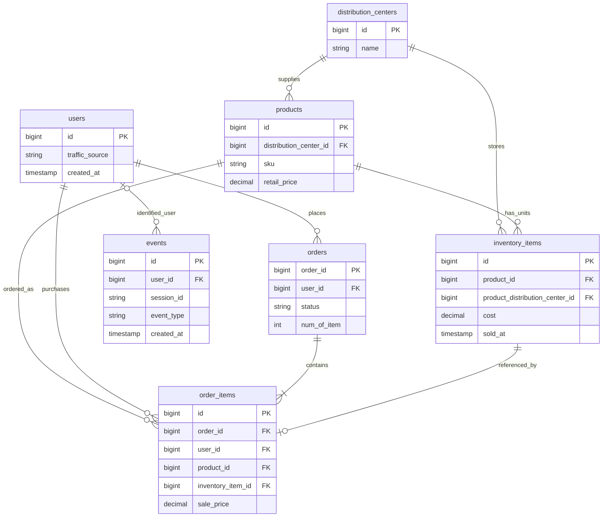

# TheLook E-Commerce: Data Dictionary, ความสัมพันธ์ตาราง และกฎทำความสะอาด

วันที่จัดทำ: 18 ตุลาคม 2026  
แหล่งข้อมูล: CSV ทั้ง 7 ไฟล์ในโฟลเดอร์ `dataset/` ของโปรเจกต์นี้  
วัตถุประสงค์: ใช้เตรียม schema, Glue ETL และคลังข้อมูลก่อนโหลดเข้า Redshift

เอกสารนี้แยก **ผลตรวจจากไฟล์จริง** ออกจาก **ข้อเสนอสำหรับการออกแบบ** ไม่ได้แก้ไขข้อมูลต้นฉบับหรือสร้างบริการ AWS ความหมายของคอลัมน์อธิบายจากชื่อฟิลด์และความสัมพันธ์ที่ตรวจพบ ยังต้องยืนยันกับเอกสารของแหล่งข้อมูล โดยเฉพาะความหมายของวันที่ สกุลเงิน และการรับรู้รายได้

## 1. ภาพรวมข้อมูลและขอบเขตการตรวจ

| ตาราง / ไฟล์ | จำนวนแถวข้อมูล ไม่รวม header | จำนวนคอลัมน์ | หนึ่งแถวแทน | คีย์หลักที่เสนอ |
|---|---:|---:|---|---|
| `distribution_centers.csv` | 10 | 4 | ศูนย์กระจายสินค้าหนึ่งแห่ง | `id` |
| `events.csv` | 2,431,963 | 13 | เหตุการณ์บนเว็บไซต์หนึ่งเหตุการณ์ | `id` |
| `inventory_items.csv` | 490,705 | 12 | สินค้าคงคลังหนึ่งชิ้น | `id` |
| `order_items.csv` | 181,759 | 11 | รายการสินค้าหนึ่งรายการในคำสั่งซื้อ | `id` |
| `orders.csv` | 125,226 | 9 | คำสั่งซื้อหนึ่งรายการ | `order_id` |
| `products.csv` | 29,120 | 9 | สินค้าหนึ่งรหัสในแค็ตตาล็อก | `id` |
| `users.csv` | 100,000 | 15 | ผู้ใช้หนึ่งคน | `id` |

ตรวจครบทุกแถวสำหรับจำนวนแถว ค่าว่างแบบ empty string และคีย์หลักซ้ำ ตรวจ FK ทั้ง 9 เส้นทางในหัวข้อความสัมพันธ์ โดยแปลง `events.user_id` เป็นตัวเลขก่อนเทียบ ตรวจการเชื่อม `orders`–`order_items` และ `order_items`–`inventory_items` เพิ่มเติม ส่วนการ parse วันเวลาตรวจทุกคอลัมน์วันที่ใน 6 ตารางที่ไม่ใช่ `events` แล้ว ไม่พบค่าที่ parse ไม่ได้ในค่าที่ไม่ว่างของตารางเหล่านั้น

ข้อจำกัด: ยังไม่ได้ตรวจทุกคอลัมน์หา whitespace-only หรือข้อความแทน null เช่น `NULL`/`N/A`, ยังไม่ได้ตรวจลำดับวันเวลา ช่วงตัวเลข ค่าติดลบ และรูปแบบอีเมลทั้งชุด และยังไม่ได้ parse วันเวลาทุกแถวของ `events` กฎด้านล่างเป็นสิ่งที่ต้องนำไปตรวจใน ETL เพิ่มเติม จึงไม่ถือว่าชุดข้อมูลผ่านการตรวจคุณภาพทุกด้านแล้ว

## 2. วิธีอ่าน Data Dictionary

- ชนิดข้อมูลเป็น **ชนิดเป้าหมายที่เสนอ** สำหรับ curated/warehouse เพราะ CSV ไม่มี schema บังคับ
- `BIGINT` ใช้กับ ID และต้องไม่มีเศษทศนิยม ห้ามแปลงผ่านตัวเลข floating point โดยไม่ตรวจความถูกต้อง
- `TIMESTAMPTZ` หมายถึงวันเวลาที่รับรู้ timezone ให้ normalize เป็น UTC และรักษา microseconds ถ้า engine ใช้ timestamp ที่ไม่มี timezone ต้องระบุ UTC ใน schema/metadata ให้ชัด
- `DECIMAL(18,6)` เป็นข้อเสนอสำหรับราคา/ต้นทุน เพื่อลดการตัดทศนิยมเร็วเกินไป การปัดเศษใช้ decimal arithmetic แบบ half-up เป็นข้อเสนอที่ทีมต้องยืนยันก่อนนำไปใช้ เก็บค่าต้นฉบับใน raw เสมอ
- `VARCHAR(n)` เป็นขนาดที่เสนอเผื่อจากข้อมูลปัจจุบัน ต้องตรวจความยาวแบบ UTF-8 bytes ก่อนสร้าง DDL จริง ห้ามตัดข้อความเงียบ ๆ
- “ว่างจริง” ในตารางหมายถึงจำนวน empty strings ที่ตรวจพบ ไม่ใช่ทุกชนิดของ missing value
- “อนุญาต NULL” เป็นข้อเสนอสำหรับ curated ข้อมูลผิดกฎต้องส่งไป quarantine พร้อมเหตุผล ไม่ใช่ทิ้งโดยไม่บันทึก
- `PK` และ `FK` เป็นข้อกำหนดทางตรรกะที่ ETL ต้องตรวจเอง ไม่ใช่หลักฐานว่าฐานข้อมูลได้บังคับความสัมพันธ์เหล่านี้แล้ว

## 3. Data Dictionary

### 3.1 distribution_centers

แหล่งข้อมูล: [distribution_centers.csv](../dataset/distribution_centers.csv)

| คอลัมน์ | ชนิดเป้าหมาย | ความหมาย / คีย์ | อนุญาต NULL | ว่างจริง |
|---|---|---|---|---:|
| `id` | BIGINT | รหัสศูนย์กระจายสินค้า; PK | ไม่ | 0 |
| `name` | VARCHAR(256) | ชื่อศูนย์กระจายสินค้า | ไม่ | 0 |
| `latitude` | DOUBLE PRECISION | ละติจูด; ตรวจช่วง -90 ถึง 90 | ไม่ | 0 |
| `longitude` | DOUBLE PRECISION | ลองจิจูด; ตรวจช่วง -180 ถึง 180 | ไม่ | 0 |

### 3.2 products

แหล่งข้อมูล: [products.csv](../dataset/products.csv)

| คอลัมน์ | ชนิดเป้าหมาย | ความหมาย / คีย์ | อนุญาต NULL | ว่างจริง |
|---|---|---|---|---:|
| `id` | BIGINT | รหัสสินค้า; PK | ไม่ | 0 |
| `cost` | DECIMAL(18,6) | ต้นทุนที่ระบุในแค็ตตาล็อก; ต้องยืนยันสกุลเงิน | ไม่ | 0 |
| `category` | VARCHAR(128) | หมวดสินค้า | ไม่ | 0 |
| `name` | VARCHAR(1024) | ชื่อสินค้า | ได้ | 2 |
| `brand` | VARCHAR(256) | แบรนด์สินค้า | ได้ | 24 |
| `retail_price` | DECIMAL(18,6) | ราคาขายปลีกที่ระบุในแค็ตตาล็อก ไม่ใช่ราคาขายจริงทุกธุรกรรม | ไม่ | 0 |
| `department` | VARCHAR(32) | แผนกสินค้า; พบ `Men`, `Women` | ไม่ | 0 |
| `sku` | VARCHAR(128) | รหัส SKU แบบข้อความ; ยังไม่ได้ยืนยัน uniqueness | ไม่ | 0 |
| `distribution_center_id` | BIGINT | FK → `distribution_centers.id` | ไม่ | 0 |

### 3.3 users

แหล่งข้อมูล: [users.csv](../dataset/users.csv)

| คอลัมน์ | ชนิดเป้าหมาย | ความหมาย / คีย์ | อนุญาต NULL | ว่างจริง |
|---|---|---|---|---:|
| `id` | BIGINT | รหัสผู้ใช้; PK | ไม่ | 0 |
| `first_name` | VARCHAR(256) | ชื่อต้น | ไม่ | 0 |
| `last_name` | VARCHAR(256) | นามสกุล | ไม่ | 0 |
| `email` | VARCHAR(512) | อีเมล; ไม่ใช้แทน PK | ไม่ | 0 |
| `age` | SMALLINT | อายุที่ระบุในชุดข้อมูล; ไม่สามารถใช้คำนวณวันเกิดที่แน่นอนได้ | ไม่ | 0 |
| `gender` | VARCHAR(32) | รหัสเพศในข้อมูล; พบ `F`, `M` | ไม่ | 0 |
| `state` | VARCHAR(256) | รัฐ/จังหวัด/เขตการปกครอง | ไม่ | 0 |
| `street_address` | VARCHAR(1024) | ที่อยู่ | ไม่ | 0 |
| `postal_code` | VARCHAR(32) | รหัสไปรษณีย์; รักษาเลขศูนย์นำหน้าและตัวอักษร | ไม่ | 0 |
| `city` | VARCHAR(256) | เมือง | ไม่ | 0 |
| `country` | VARCHAR(128) | ประเทศ | ไม่ | 0 |
| `latitude` | DOUBLE PRECISION | ละติจูดที่ระบุ; ตรวจช่วง -90 ถึง 90 | ไม่ | 0 |
| `longitude` | DOUBLE PRECISION | ลองจิจูดที่ระบุ; ตรวจช่วง -180 ถึง 180 | ไม่ | 0 |
| `traffic_source` | VARCHAR(64) | ช่องทางที่ระบุสำหรับผู้ใช้; ไม่ถือว่าเป็น attribution ของทุกคำสั่งซื้อโดยอัตโนมัติ | ไม่ | 0 |
| `created_at` | TIMESTAMPTZ | วันเวลาสร้างผู้ใช้ตามแหล่งข้อมูล | ไม่ | 0 |

ค่า `traffic_source` ที่พบ: `Search`, `Organic`, `Facebook`, `Email`, `Display` ค่าชื่อ ที่อยู่ อีเมล และ IP ในตารางอื่นควรเลือกส่งไปชั้น BI เฉพาะเมื่อมีความจำเป็นต่อรายงาน

### 3.4 orders

แหล่งข้อมูล: [orders.csv](../dataset/orders.csv)

| คอลัมน์ | ชนิดเป้าหมาย | ความหมาย / คีย์ | อนุญาต NULL | ว่างจริง |
|---|---|---|---|---:|
| `order_id` | BIGINT | รหัสคำสั่งซื้อ; PK | ไม่ | 0 |
| `user_id` | BIGINT | ผู้สั่งซื้อ; FK → `users.id` | ไม่ | 0 |
| `status` | VARCHAR(32) | สถานะคำสั่งซื้อ | ไม่ | 0 |
| `gender` | VARCHAR(32) | เพศที่บันทึกในแถวคำสั่งซื้อ; อย่าทับด้วยข้อมูลผู้ใช้ก่อนยืนยันความหมาย | ไม่ | 0 |
| `created_at` | TIMESTAMPTZ | วันเวลาสร้างคำสั่งซื้อ | ไม่ | 0 |
| `returned_at` | TIMESTAMPTZ | วันเวลาคืนตามแหล่งข้อมูล | ได้ | 112,696 |
| `shipped_at` | TIMESTAMPTZ | วันเวลาส่งสินค้า | ได้ | 43,765 |
| `delivered_at` | TIMESTAMPTZ | วันเวลาส่งถึง | ได้ | 81,342 |
| `num_of_item` | INTEGER | จำนวนรายการสินค้าในคำสั่งซื้อ ใช้ตรวจเทียบกับจำนวนแถวใน `order_items` | ไม่ | 0 |

### 3.5 order_items

แหล่งข้อมูล: [order_items.csv](../dataset/order_items.csv)

| คอลัมน์ | ชนิดเป้าหมาย | ความหมาย / คีย์ | อนุญาต NULL | ว่างจริง |
|---|---|---|---|---:|
| `id` | BIGINT | รหัสรายการสินค้าในคำสั่งซื้อ; PK | ไม่ | 0 |
| `order_id` | BIGINT | FK → `orders.order_id` | ไม่ | 0 |
| `user_id` | BIGINT | FK → `users.id`; ต้องตรงกับผู้ใช้ในคำสั่งซื้อที่อ้างถึง | ไม่ | 0 |
| `product_id` | BIGINT | FK → `products.id` | ไม่ | 0 |
| `inventory_item_id` | BIGINT | FK → `inventory_items.id`; ชุดนี้ไม่พบการใช้รหัสซ้ำ | ไม่ | 0 |
| `status` | VARCHAR(32) | สถานะของรายการสินค้า | ไม่ | 0 |
| `created_at` | TIMESTAMPTZ | วันเวลาสร้างรายการตามแหล่งข้อมูล; อย่าสมมติว่าเท่ากับวันสร้าง order | ไม่ | 0 |
| `shipped_at` | TIMESTAMPTZ | วันเวลาส่งของรายการ | ได้ | 63,478 |
| `delivered_at` | TIMESTAMPTZ | วันเวลาส่งถึงของรายการ | ได้ | 117,918 |
| `returned_at` | TIMESTAMPTZ | วันเวลาคืนของรายการ | ได้ | 163,527 |
| `sale_price` | DECIMAL(18,6) | ราคาขายของรายการ ใช้เป็นฐานคำนวณยอดขายเมื่อกำหนดสถานะที่นับแล้ว | ไม่ | 0 |

ไม่มีคอลัมน์ quantity ในไฟล์นี้ การใช้จำนวนแถวเป็นจำนวนหน่วยต้องยืนยันกติกาว่าหนึ่งรายการแทนหนึ่งชิ้น ซึ่งสอดคล้องกับการอ้าง `inventory_item_id` ในข้อมูลชุดนี้

### 3.6 inventory_items

แหล่งข้อมูล: [inventory_items.csv](../dataset/inventory_items.csv)

| คอลัมน์ | ชนิดเป้าหมาย | ความหมาย / คีย์ | อนุญาต NULL | ว่างจริง |
|---|---|---|---|---:|
| `id` | BIGINT | รหัสสินค้าคงคลังรายชิ้น; PK | ไม่ | 0 |
| `product_id` | BIGINT | FK → `products.id` | ไม่ | 0 |
| `created_at` | TIMESTAMPTZ | วันเวลาสร้างรายการสินค้าคงคลังตามแหล่งข้อมูล | ไม่ | 0 |
| `sold_at` | TIMESTAMPTZ | วันเวลาที่ระบุว่าขาย; ต้องยืนยันความหมายก่อนใช้ตัดสต็อก | ได้ | 308,946 |
| `cost` | DECIMAL(18,6) | ต้นทุนที่บันทึกสำหรับสินค้าชิ้นนี้ | ไม่ | 0 |
| `product_category` | VARCHAR(128) | หมวดสินค้าที่บันทึกใน inventory | ไม่ | 0 |
| `product_name` | VARCHAR(1024) | ชื่อสินค้าที่บันทึกใน inventory | ได้ | 29 |
| `product_brand` | VARCHAR(256) | แบรนด์ที่บันทึกใน inventory | ได้ | 401 |
| `product_retail_price` | DECIMAL(18,6) | ราคาปลีกที่บันทึกใน inventory | ไม่ | 0 |
| `product_department` | VARCHAR(32) | แผนกสินค้าที่บันทึกใน inventory | ไม่ | 0 |
| `product_sku` | VARCHAR(128) | SKU ที่บันทึกใน inventory | ไม่ | 0 |
| `product_distribution_center_id` | BIGINT | FK → `distribution_centers.id` | ไม่ | 0 |

อย่าเขียนทับคอลัมน์ `product_*` ด้วยค่าปัจจุบันจาก `products` อัตโนมัติ เพราะยังไม่ได้ยืนยันว่าเป็นสำเนาปัจจุบันหรือ snapshot ณ เวลาหนึ่ง และยังไม่ได้ตรวจเทียบ attribute เหล่านี้ทั้งหมด

### 3.7 events

แหล่งข้อมูล: [events.csv](../dataset/events.csv)

| คอลัมน์ | ชนิดเป้าหมาย | ความหมาย / คีย์ | อนุญาต NULL | ว่างจริง |
|---|---|---|---|---:|
| `id` | BIGINT | รหัสเหตุการณ์; PK | ไม่ | 0 |
| `user_id` | BIGINT | FK → `users.id` เมื่อมีค่า; ต้อง normalize เลขแบบ `35092.0` | ได้ | 1,125,671 |
| `sequence_number` | INTEGER | ลำดับเหตุการณ์ตามแหล่งข้อมูล; ต้องยืนยันขอบเขตของลำดับก่อนตั้ง unique constraint | ไม่ | 0 |
| `session_id` | VARCHAR(128) | รหัส session แบบข้อความ; หนึ่ง session มีหลายเหตุการณ์ได้ | ไม่ | 0 |
| `created_at` | TIMESTAMPTZ | วันเวลาเกิดเหตุการณ์ | ไม่ | 0 |
| `ip_address` | VARCHAR(64) | IP address แบบข้อความ | ไม่ | 0 |
| `city` | VARCHAR(256) | เมืองที่ระบุสำหรับเหตุการณ์ | ไม่ | 0 |
| `state` | VARCHAR(256) | รัฐ/จังหวัดที่ระบุสำหรับเหตุการณ์ | ไม่ | 0 |
| `postal_code` | VARCHAR(32) | รหัสไปรษณีย์แบบข้อความ | ไม่ | 0 |
| `browser` | VARCHAR(128) | browser ที่ระบุ | ไม่ | 0 |
| `traffic_source` | VARCHAR(64) | ช่องทางของเหตุการณ์; อาจต่างจากของผู้ใช้ | ไม่ | 0 |
| `uri` | VARCHAR(4096) | URI ที่เข้าถึง; รักษาตัวพิมพ์และ query string ของต้นฉบับ | ไม่ | 0 |
| `event_type` | VARCHAR(64) | ประเภทเหตุการณ์; ต้องเก็บ distinct values เพื่อกำหนดรายการค่าที่รองรับก่อนใช้งาน | ไม่ | 0 |

ขนาดข้อความของ `events` เป็นค่าประมาณสำหรับออกแบบ ยังไม่ได้ตรวจ maximum UTF-8 byte length ทั้งชุด ต้องตรวจและขยาย schema ตามจริงก่อนโหลด

## 4. แผนภาพความสัมพันธ์ของตารางต้นทาง

นี่คือ ER diagram ของข้อมูลต้นทาง ไม่ใช่ star schema ของคลังข้อมูล ป้าย PK/FK เป็นข้อกำหนดที่เสนอจากไฟล์ที่ตรวจ



อ่านสัญลักษณ์: `||` = หนึ่งรายการ, `o|` = ศูนย์หรือหนึ่ง, `o{` = ศูนย์หรือหลาย, `|{` = หนึ่งหรือหลาย ความสัมพันธ์ inventory ต่อ order item แบบศูนย์หรือหนึ่งอ้างอิงจากผลที่ไม่พบ `inventory_item_id` ซ้ำในชุดนี้ ต้องยืนยันอีกครั้งหากรองรับการขายซ้ำหรือประวัติคืนสินค้าในอนาคต

| ตารางลูก.คอลัมน์ | ตารางแม่.คอลัมน์ | NULL ที่ยอมรับ | ผลตรวจคีย์ที่ไม่ว่าง |
|---|---|---|---|
| `products.distribution_center_id` | `distribution_centers.id` | ไม่ | พบคู่ครบ |
| `inventory_items.product_id` | `products.id` | ไม่ | พบคู่ครบ |
| `inventory_items.product_distribution_center_id` | `distribution_centers.id` | ไม่ | พบคู่ครบ |
| `orders.user_id` | `users.id` | ไม่ | พบคู่ครบ |
| `order_items.order_id` | `orders.order_id` | ไม่ | พบคู่ครบ |
| `order_items.user_id` | `users.id` | ไม่ | พบคู่ครบ |
| `order_items.product_id` | `products.id` | ไม่ | พบคู่ครบ |
| `order_items.inventory_item_id` | `inventory_items.id` | ไม่ | พบคู่ครบ |
| `events.user_id` | `users.id` | ได้ | พบคู่ครบทั้ง 1,306,292 แถวที่ไม่ว่าง หลัง normalize ตัวเลข |

ข้อควรระวังในการ join:

- `orders` มีหลาย `order_items` ห้ามรวม `num_of_item` จากแถวที่ join แล้วตรง ๆ เพราะค่าระดับ order จะซ้ำ
- `products` มี inventory หลายชิ้น หากต้องการต้นทุนของรายการขายให้ join ผ่าน `order_items.inventory_item_id = inventory_items.id` การ join ผ่าน `product_id` เพียงอย่างเดียวจะเพิ่มจำนวนแถว
- `events` และ `orders` ต่างมีหลายแถวต่อผู้ใช้ ห้าม join ทั้งสองด้วย `user_id` แล้ว SUM ยอดขายโดยตรง ให้ aggregate แยกตามระดับที่ต้องการ หรือกำหนด attribution rule ก่อน
- events ไม่มี `order_id` หรือ `product_id` โดยตรง ห้ามสมมติว่าเชื่อมธุรกรรมได้แน่นอนจาก `user_id` หรือ URI เพียงอย่างเดียว

## 5. ผลตรวจเพิ่มเติมที่ยืนยันแล้ว

| รายการตรวจ | ผล |
|---|---|
| คีย์หลักซ้ำในทั้ง 7 ตาราง | 0 แถวซ้ำตามคีย์ |
| คีย์หลักเป็น empty string | 0 แถว |
| จำนวน order items ต่อ order เทียบ `orders.num_of_item` | ไม่ตรงกัน 0 orders |
| `order_items.user_id` เทียบ `orders.user_id` ของ order เดียวกัน | ไม่ตรงกัน 0 แถว |
| `order_items.status` เทียบ `orders.status` ของ order เดียวกัน | ไม่ตรงกัน 0 แถวใน snapshot นี้ |
| `order_items.product_id` เทียบ product ของ inventory item ที่อ้างถึง | ไม่ตรงกัน 0 แถว |
| `inventory_item_id` ถูกอ้างซ้ำใน order_items | 0 แถวซ้ำ |

สถานะที่พบในทั้ง orders และ order_items: `Processing`, `Shipped`, `Complete`, `Cancelled`, `Returned`

ข้อมูลนี้เป็น snapshot ในอดีต ไม่ใช่ข้อมูลปี 2026: `orders.created_at` มีช่วง 2019-01-06 ถึง 2024-01-17 (UTC) และบางคอลัมน์ เช่น `returned_at` มีวันถึง 2024-01-27 ห้ามใช้วันที่จัดทำเอกสารเป็นวันที่ snapshot ของข้อมูล และห้ามลบวันเหล่านี้เพียงเพราะเกินวันสร้าง order ล่าสุด

## 6. กฎทำความสะอาดที่เสนอ

### 6.1 ระดับข้อมูลและวิธีรับมือข้อผิดพลาด

1. **Raw:** เก็บ CSV ต้นฉบับและ header ตามเดิม ไม่เขียนทับ บันทึกชื่อไฟล์ checksum เวลานำเข้า และ `batch_id`
2. **Staging:** อ่านด้วย CSV parser ที่รองรับ quoting/escaped quotes และบรรทัดใหม่ในฟิลด์ อ่านรหัสเป็นข้อความก่อนตรวจและแปลงชนิด เก็บ source file และหมายเลข record เพื่อย้อนกลับได้
3. **Curated:** ใช้ schema ที่กำหนด ทำเฉพาะการแปลงที่มีกฎชัดเจน และเก็บ `batch_id`, `source_file`, `ingested_at` เป็น metadata เพิ่มจากคอลัมน์ต้นทาง
4. **Quarantine:** เก็บแถวที่ไม่ผ่าน พร้อม `rule_id`, ชื่อคอลัมน์, ค่าต้นฉบับ และเหตุผล จำกัดการเผยแพร่ค่าระบุตัวบุคคลใน log
5. **Warning:** เก็บแถวไว้และติด flag เมื่อกฎยังเป็นข้อสงสัยทางธุรกิจ ไม่ปรับค่าหรือทิ้งข้อมูลเพื่อให้ผ่านการตรวจ

### 6.2 กฎทั่วไป

| ID | กฎ | การจัดการ |
|---|---|---|
| G01 | header และจำนวน field ของแต่ละ record ต้องตรง schema | หยุด batch ของตารางเมื่อ header ผิด; quarantine record ที่ parse ไม่ได้ พร้อมรักษาต้นฉบับ |
| G02 | ตรวจ encoding และ CSV delimiter/quote ให้ถูกก่อนอ่านเต็มชุด | ใช้ UTF-8 เป็นค่าเริ่มต้นที่เสนอ; หาก decode ไม่ได้ให้ตรวจ encoding จริง ห้ามแทนตัวอักษรเสียแบบเงียบ |
| G03 | แปลง empty/whitespace-only เป็น NULL สำหรับฟิลด์ที่อนุญาต | ถ้าเป็น required field ให้ quarantine; อย่าแทนด้วย 0 หรือวันที่ปัจจุบัน; ข้อความ `NULL`/`N/A` ต้องตกลงเพิ่มก่อนแปลง |
| G04 | trim ช่องว่างหัวท้ายของชื่อ หมวด สถานะ และรหัสที่ตกลงให้ trim | ห้ามยุบช่องว่างภายในข้อความทั้งหมด ห้าม lowercase SKU, session ID หรือ URI อัตโนมัติ |
| G05 | ID ต้องเป็นเลขจำนวนเต็มบวก อยู่ในช่วง BIGINT | ใช้ decimal/exact parser; `35092.0` แปลงได้เมื่อไม่มีเศษ แต่ `35092.5` ต้อง quarantine; ตรวจคีย์ซ้ำหลัง normalize อีกครั้ง |
| G06 | PK ต้องไม่ว่างและไม่ซ้ำ | หากแถวเหมือนกันทุกคอลัมน์ให้ deduplicate แบบมีบันทึกได้ตามกติกาที่ตกลง; ถ้า PK เดียวแต่ค่าต่างกันให้พักทั้งกลุ่มเพื่อสอบสวน ห้ามเลือกแถวล่าสุดจากลำดับไฟล์ |
| G07 | FK ที่ไม่ว่างต้องพบ parent | ตรวจหลัง parent โหลดครบใน batch เดียวกัน; ไม่พบให้ quarantine/pending และ retry หลัง parent พร้อม ไม่สร้าง parent ปลอมโดยไม่ตกลง |
| G08 | วันที่ต้อง parse ได้พร้อม timezone และเศษวินาที | normalize UTC; ค่าที่ไม่ว่างแต่ parse ไม่ได้ให้ quarantine; ถ้า input ไม่มี timezone ให้พักตรวจ ไม่เดาว่าเป็นเวลาไทย |
| G09 | ราคา/ต้นทุนต้องเป็นเลข finite ที่เก็บใน DECIMAL(18,6) ได้ | ใช้ decimal arithmetic; เก็บต้นฉบับและวัดผลต่างจากการปัดเศษ; overflow/ค่าที่ไม่ใช่ตัวเลขให้ quarantine; ค่าติดลบให้พักตรวจตามนิยามธุรกิจ |
| G10 | ความยาวข้อความต้องไม่เกิน schema เป้าหมาย | ตรวจ UTF-8 bytes ทุกตารางก่อนสร้าง DDL; ขยาย schema เมื่อสมเหตุสมผล ห้าม truncate |
| G11 | ค่าหมวดหมู่ต้องตรงรายการที่รองรับ | map เฉพาะรูปแบบที่ยืนยัน เช่นช่องว่างหัวท้าย; ค่าใหม่ให้ warning และทบทวน ไม่บังคับเข้าค่าที่ใกล้ที่สุด |
| G12 | โหลดซ้ำแล้วต้องไม่เพิ่มแถวเดิมซ้ำ | สำหรับ snapshot นี้เสนอ full refresh ผ่าน staging แล้วสลับเมื่อผ่าน checks; หากเปลี่ยนเป็น incremental ต้องออกแบบ merge และการลบเพิ่ม เพราะไม่มี updated_at ทุกตาราง |

### 6.3 กฎเฉพาะตารางและความสัมพันธ์

| ID | ขอบเขต | กฎ / การจัดการ |
|---|---|---|
| T01 | events.user_id | เก็บ 1,125,671 แถวที่คีย์ว่างไว้ได้ ไม่ inner join กับ users จนเหตุการณ์เหล่านี้หาย ใช้ LEFT JOIN; หาก mart ต้องมี customer key ใช้แถว Unknown ที่กำหนดเฉพาะใน dimension |
| T02 | products / inventory_items | ชื่อและแบรนด์ที่ว่างให้คง NULL ใน curated อาจแสดง “ไม่ระบุ” ที่ชั้นรายงาน; ไม่เดาชื่อจาก SKU ไม่เติมจากอีกตารางโดยไม่มี provenance |
| T03 | orders / order_items | returned_at, shipped_at, delivered_at ว่างได้ตามสถานะ ห้ามเติมวันสร้างลงแทน; ตรวจ cross-tab สถานะกับวันเพื่อยืนยันกติกาจริงก่อนบังคับ |
| T04 | inventory_items | sold_at ว่างได้ ไม่สรุปสถานะ stock/available จากค่านี้อย่างเดียวจนยืนยันนิยาม cancelled/returned |
| T05 | orders.num_of_item | ต้องเป็นจำนวนเต็มบวกและเท่ากับ COUNT(order_items) ต่อ order หากผิดให้พักชุดคำสั่งซื้อและรายการที่เกี่ยวข้องก่อนเผยแพร่ mart |
| T06 | order_items / orders | user_id ต้องตรงกัน; หากไม่ตรงให้ quarantine กลุ่มที่เกี่ยวข้อง ส่วนสถานะไม่ตรงให้ warning ก่อน เพราะระบบอนาคตอาจส่งแยกรายการได้ |
| T07 | order_items / inventory_items | product_id ของรายการขายต้องตรงกับสินค้าคงคลังที่อ้างถึง; หากไม่ตรงให้พักรายการ ห้ามแก้ product_id เอง |
| T08 | order_items.inventory_item_id | ตรวจการอ้างซ้ำ; ชุดนี้ไม่พบซ้ำ หากพบใน batch ใหม่ให้ตรวจว่าขายซ้ำ/คืน/ประวัติเปลี่ยนแปลงหรือไม่ ก่อนตั้งเป็น error ถาวร |
| T09 | วันที่ใน orders / order_items / inventory_items | ตรวจ shipped ≥ created, delivered ≥ shipped, returned ≥ delivered และ sold ≥ inventory created เมื่อทั้งสองค่ามี; flag ความผิดปกติก่อน ห้ามสลับวันที่เอง ต้องยืนยัน semantics โดยเฉพาะ created_at ของ item |
| T10 | users.age | ต้องเป็นจำนวนเต็ม; เสนอช่วง 0–120 เป็น warning rule เพื่อทบทวน ไม่อนุมานวันเกิดและไม่แก้อายุเป็นค่ากลาง |
| T11 | users / distribution_centers | latitude อยู่ -90..90 และ longitude อยู่ -180..180; นอกช่วงให้ quarantine; ไม่แทนค่าว่างด้วยพิกัด 0,0 |
| T12 | users.email | trim แล้วตรวจรูปแบบเบื้องต้นเพื่อ flag; ไม่ deduplicate ผู้ใช้ด้วย email และไม่ lowercase ทั้ง address โดยไม่มีข้อกำหนด |
| T13 | events | ตรวจ event_type/browser/traffic_source distinct values, วันเวลา, ความยาว URI และ sequence_number ก่อนใช้จริง; การซ้ำของ session_id เพียงอย่างเดียวไม่ใช่ duplicate event |
| T14 | product attributes ใน inventory | ตรวจความต่างกับ products เพื่อรายงานก่อน ไม่เขียนทับต้นทุน/ชื่อ/ศูนย์กระจายสินค้าจนตกลงว่าตารางใดเป็นแหล่งอ้างอิงสำหรับแต่ละ metric |

### 6.4 กฎธุรกิจที่ทีมต้องตกลงก่อนทำ fact_sales

| หัวข้อ | ข้อเสนอเริ่มต้น / สิ่งที่ต้องยืนยัน |
|---|---|
| Grain | หนึ่งแถวต่อ `order_items.id` และเก็บ `order_id`, `inventory_item_id` เพื่อ trace กลับ |
| วันที่รายงาน | แยกวันสร้างคำสั่งซื้อ วันสร้างรายการ วันส่ง และวันคืน ไม่รวมเป็นคอลัมน์เดียวโดยไม่ระบุความหมาย |
| ยอดขาย | ใช้ sale_price ของรายการที่อยู่ในสถานะที่ทีมตกลง ไม่ใช้ products.retail_price แทนราคาธุรกรรม |
| Cancelled / Returned | แสดงแยกไว้ก่อน การคำนวณ net sales ต้องกำหนดว่าจะตัดออกหรือบันทึกยอดคืนเมื่อใด และข้อมูลมี refund amount เพียงพอหรือไม่ |
| สกุลเงิน | ไม่มีคอลัมน์ currency ในไฟล์ ต้องยืนยันจากแหล่งข้อมูล ห้ามติดป้าย THB/USD โดยเดา |
| ต้นทุน | เสนอใช้ inventory_items.cost ที่ join ผ่าน inventory_item_id เมื่อความหมายได้รับการยืนยัน; ผลต่าง sale_price − cost เป็นกำไรขั้นต้นตามต้นทุนที่มี ไม่ใช่กำไรสุทธิ |
| จำนวน orders | ใช้ COUNT DISTINCT order_id ภายใต้ตัวกรองที่กำหนด ไม่ใช้ COUNT(*) ของ fact_sales |
| ลูกค้าและสินค้าเปลี่ยนแปลง | เริ่มจาก dimension แบบ snapshot ได้; ไม่มีข้อมูลเพียงพอที่จะสร้างประวัติ SCD Type 2 ย้อนหลังอย่างแท้จริง ห้ามแต่ง effective dates |
| Traffic attribution | แยก traffic_source ของ users กับ events; หากต้องการ conversion/funnel ให้กำหนด session/window/ตัวตั้งตัวหารต่างหาก |

## 7. แบบคลังข้อมูลเริ่มต้นที่เสนอ

| ตารางปลายทาง | แหล่งข้อมูลหลัก | ระดับข้อมูล / หมายเหตุ |
|---|---|---|
| `dim_users` | users | หนึ่งแถวต่อ user ใน snapshot เริ่มต้น เลือก attributes เท่าที่รายงานใช้ |
| `dim_products` | products | หนึ่งแถวต่อ product ใน snapshot เริ่มต้น |
| `dim_date` | สร้างจากช่วงวันที่ที่ตรวจจริง | หนึ่งแถวต่อวัน; รองรับหลายบทบาท เช่น order date, ship date, return date |
| `dim_distribution_centers` | distribution_centers | หนึ่งแถวต่อศูนย์กระจายสินค้า |
| `fact_sales` | order_items + orders + inventory_items | หนึ่งแถวต่อ order item; ตรวจจำนวนแถวหลัง join ต้องไม่เพิ่ม |
| `fact_events` ในระยะถัดไป | events | หนึ่งแถวต่อ event; แยกจาก fact_sales |

ยังไม่จำเป็นต้องสร้าง fact inventory รายวันในรอบแรก เพราะไฟล์นี้ไม่ได้ให้ snapshot ยอดคงเหลือของทุกวันโดยตรง หากต้องการรายงาน stock ย้อนหลังต้องนิยามการเคลื่อนไหวและการคืนเพิ่มเติม

## 8. โครงสร้างไฟล์และลำดับงานที่เสนอ

```text
raw/<batch_id>/distribution_centers/distribution_centers.csv
raw/<batch_id>/products/products.csv
raw/<batch_id>/users/users.csv
raw/<batch_id>/orders/orders.csv
raw/<batch_id>/inventory_items/inventory_items.csv
raw/<batch_id>/order_items/order_items.csv
raw/<batch_id>/events/events.csv

curated/<batch_id>/<table_name>/*.parquet
quarantine/<batch_id>/<table_name>/...
temp/...
```

`batch_id` หมายถึงรอบนำเข้า ไม่ใช่วันที่เกิดธุรกรรมหรือวันที่ snapshot ที่ทราบแล้ว แต่ละ table ต้องแยก prefix เพื่อไม่ให้ schema ของหลายตารางปะปนกัน ยังไม่ต้อง partition ละเอียดจนมีไฟล์เล็กจำนวนมาก

ลำดับทำงาน:

1. ยืนยันกฎธุรกิจในข้อ 6.4 พร้อมบันทึกเวอร์ชัน schema และ cleaning rules
2. เก็บ raw พร้อม checksum และ manifest ระบุจำนวนแถว/ขนาดไฟล์/เวลา ingest
3. โหลด distribution_centers, products, users ก่อน แล้ว inventory_items, orders, order_items; events โหลดหลัง users เมื่อจะทำส่วนพฤติกรรม
4. ตรวจและแปลง staging → curated ตามกฎ ตรวจ parent ครบก่อนตัดสิน orphan
5. ทดสอบ subset โดยเลือก orders ก่อน แล้วดึง order_items, users, products, inventory_items และ distribution_centers ที่เกี่ยวข้องให้ครบ ห้ามสุ่มแต่ละไฟล์แยกกันจนคีย์ขาดคู่
6. โหลด curated เข้า staging ของ warehouse สร้าง dimension/fact แล้วตรวจผลก่อนเผยแพร่
7. ทดลองโหลด batch เดิมซ้ำ ผลลัพธ์ต้องไม่เพิ่มแถวหรือยอดเงินซ้ำ

## 9. เกณฑ์ตรวจรับ ETL

- จำนวนแถวต้นทาง = accepted + quarantined + duplicates ที่ตัดออกอย่างมีบันทึก โดยนับแต่ละแถวในหมวดเดียวกันเท่านั้น แถวที่มี warning ยังอยู่ใน accepted และทุกแถวที่ไม่ส่งต่อมีเหตุผลย้อนกลับได้
- curated PK ไม่มี NULL/ซ้ำหลัง normalize และ FK ที่ไม่ว่างพบ parent ครบ ส่วน events.user_id ที่ NULL ยังเก็บไว้ครบ
- วันที่ parse ไม่ได้ ข้อความยาวเกิน schema และ decimal overflow ต้องไม่มีหลุดเข้า curated โดยเงียบ
- รายงานจำนวนค่าว่างและสถานะก่อน–หลัง ทุกความเปลี่ยนแปลงอธิบายด้วย rule ID ได้
- orders.num_of_item ตรงกับจำนวนรายการในชุดที่ยอมรับ หากมี quarantine ลูกต้อง flag/พัก parent ที่เกี่ยวข้องด้วย
- join fact_sales กับ parent ต้องรักษาหนึ่งแถวต่อ order_items.id; ถ้าไม่มีแถวถูกคัดออก จำนวนควรเท่ากับ 181,759
- เทียบ SUM(sale_price) ของประชากรและสถานะเดียวกันก่อน–หลัง โดยใช้ decimal และรายงานผลต่างจาก rounding แยกจากผลต่างเพราะคัดแถว ห้ามใช้ tolerance กลบความผิดพลาด
- ทดสอบโหลดซ้ำแล้วจำนวนคีย์และยอดรวมคงเดิม เก็บผลตรวจไว้กับ batch_id

สถานะการตรวจเพิ่มเติม: notebook ได้เพิ่มการตรวจลำดับวันเวลา ช่วงตัวเลข whitespace/null-like tokens และ events timestamps แล้ว ผลรอบล่าสุดมีคำเตือนตามข้อ 10 ด้านล่าง ยังต้องตรวจความยาว UTF-8 bytes, ความหมายของหมวดหมู่ events, ความต่าง product attributes และนิยาม metric ตามขอบเขตรายงาน การมีเอกสารนี้ไม่ได้หมายความว่าการตรวจทุกด้านผ่านแล้ว

## 10. กฎชั่วคราวที่รับทราบแล้ว แต่ยังรอยืนยันจากต้นทาง

วันที่ตัดสินใจ: 18 ตุลาคม 2026  
เวอร์ชันกฎ: `provisional-v1`  
สถานะ: **สมมติฐานที่รอยืนยัน**  
ขอบเขต: CSV snapshot ในโปรเจกต์นี้ โดยบันทึก SHA-256 และจำนวนแถวไว้ใน [dq_known_issues_baseline.json](../code/dq_known_issues_baseline.json)

ข้อนี้เป็นข้อยกเว้นที่ระบุชัดต่อคำแนะนำเดิมเรื่องห้ามเปลี่ยนข้อความคล้าย NULL ก่อนยืนยัน: อนุญาตให้แปลงเฉพาะข้อความ `null` ในคอลัมน์ใหม่ `city_clean` ชั่วคราว โดยยังเก็บ `city` เดิมครบ ไม่ใช่การยืนยันว่าค่าดิบผิด ส่วน notebook ก่อนหน้าที่สรุปว่าเก็บค่าเดิมรอยืนยันยังคงถูกต้องสำหรับคอลัมน์ดิบ

### 10.1 CITY-01: city เป็นข้อความ null

กฎสำหรับ users และ events:

1. ไม่แก้ `city` ต้นฉบับ
2. เพิ่ม `city_clean` ชนิดข้อความ nullable โดยแปลงเฉพาะค่าที่หลัง trim และ casefold เท่ากับ `null` เป็น NULL จริง ค่าชื่อเมืองอื่นคงเดิม ไม่แปลง `NA`, `N/A`, `None` หรือ `NaN` ตามกฎนี้
3. เพิ่ม `city_missing_token` ชนิด boolean เป็น true เฉพาะแถวที่ถูกแปลงตามข้อ 2 ค่าว่างจริงเดิมยังคงว่าง แต่แฟล็กนี้ไม่ใช้แทน missing ทั้งหมด
4. ไม่เติมค่าจาก postal_code, users.city หรือพิกัด และไม่ลบแถว
5. ชั้นรายงานใช้ `city_clean` และแสดงค่าว่างเป็น Unknown หรือแยกกลุ่มไว้ ไม่รวมเป็นเมืองชื่อ null

หลักฐานจาก notebook: users พบ 958/100,000 แถว (0.958%) และ events พบ 23,080/2,431,963 แถว (ประมาณ 0.949%) พบกลุ่มพื้นที่ country/state/postal_code ของ users 136 กลุ่ม และ state/postal_code ของ events 141 กลุ่ม ไม่พบชื่อเมืองอื่นที่ผ่านตัวกรอง candidate ในกลุ่มพื้นที่เดียวกัน จึงไม่มีหลักฐานเพียงพอที่จะเติมชื่อทดแทน

สัดส่วนที่ใกล้กันและการปรากฏในหลายพื้นที่สอดคล้องกับสมมติฐาน missing token แต่ไม่ได้พิสูจน์ที่มาของ token หรือยืนยันว่าไม่มีสถานที่ชื่อนี้ events ไม่มี country จึงห้ามอ้างว่าตรวจประเทศของ events โดยตรงแล้ว

หากต้นทางยืนยันว่าเป็นชื่อสถานที่จริง ให้ยกเลิกการ mask และสร้าง city_clean ใหม่จาก city เดิม พร้อมเวอร์ชันกฎใหม่

### 10.2 DATE-01: item shipped_at ก่อน created_at

คำอธิบาย `order_items.created_at` ที่ผู้ใช้ยืนยันคือ “Timestamp indicating when the order item was created.” สิ่งที่ยังต้องยืนยันคือเหตุใดเวลาสร้างรายการจึงอยู่หลังเวลาส่งในบางแถว ไม่ใช่เดาเพิ่มเติมว่าเป็นเวลาจัดสรรสินค้าหรือเวลาบันทึกแถว

- ไม่แก้ `order_items.created_at` หรือ `shipped_at` และไม่ลบแถว
- เพิ่ม `item_shipped_before_created` ชนิด nullable boolean: true เมื่อ shipped_at < created_at, false เมื่อเปรียบเทียบได้และไม่ผิดลำดับ, NULL เมื่อวันไม่ครบ/parse ไม่ได้/ไม่มี timezone
- เพิ่ม `item_dates_comparable` ชนิด boolean เพื่อแยกแถวที่เปรียบเทียบได้ออกจากแถวที่แฟล็กเป็น NULL
- ยังไม่ใช้ order_items.created_at คำนวณระยะเวลา จนกว่าสาเหตุได้รับการยืนยัน
- ถ้ามีโจทย์รายงานระยะเวลา ให้ใช้วันที่ระดับ order เป็นฐานชั่วคราวหลังตรวจคู่วันที่: created_at → shipped_at วัดเวลาจนส่งออก; created_at → delivered_at วัดเวลาจนส่งถึง; shipped_at → delivered_at วัดเวลาขนส่ง ไม่เรียกทั้งสามอย่างเป็น metric เดียวกัน และยังไม่จำเป็นต้องคำนวณในขั้น cleaning

หลักฐาน: 35,872 แถวผิดลำดับจาก 118,281 แถวที่มีคู่วันที่และ timezone ใช้ได้ (30.33%) ครอบคลุม 20,549 orders; ในกลุ่มที่เตือน วันส่ง item ตรงกับวันส่ง order ทุกแถว แต่วันสร้าง item ต่างจากวันสร้าง order ทุกแถว ผลนี้ไม่พิสูจน์ว่าค่าใดต้องถูกเขียนทับ

การไม่พบวันส่ง order ก่อนวันสร้าง order ใช้กับแถวที่มีข้อมูลเปรียบเทียบได้เท่านั้น ไม่ใช่การรับรองลำดับวันทุกชนิดหรือทุกรายการที่วันยังว่าง และไม่ใช้สัดส่วนหรือช่วงเวลาที่พบเป็นหลักฐานว่าสาเหตุได้รับการยืนยันแล้ว

### 10.3 Known issue และการตรวจการเปลี่ยน snapshot

| Issue ID | ตาราง | จำนวนที่คาด | ตัวหารที่คาด | สถานะเมื่อเงื่อนไขครบ |
|---|---|---:|---:|---|
| CITY-01-users | users | 958 | 100,000 | KNOWN_ISSUE / รอยืนยัน |
| CITY-01-events | events | 23,080 | 2,431,963 | KNOWN_ISSUE / รอยืนยัน |
| DATE-01-items | order_items | 35,872 | 118,281 แถวที่เทียบวันได้ | KNOWN_ISSUE / รอยืนยัน |

จำนวนเหล่านี้ผูกกับ snapshot ที่มี SHA-256 ในไฟล์ baseline ไม่ใช่เป้าหมายถาวรของข้อมูลในอนาคต `KNOWN_ISSUE` หมายถึงรับทราบภายใต้สมมติฐาน ไม่ใช่ PASS และไม่ใช่การยืนยันจากต้นทาง

Notebook เก็บ `dq_summary` เป็นผลดิบของการตรวจ และสร้าง `dq_review_summary` เป็นผลหลังทบทวน พร้อม `known_issue_review` สำหรับเงื่อนไข baseline หากจำนวนปัญหา ตัวหาร จำนวนแถว หรือ SHA-256 เปลี่ยน ให้ WARN ใหม่ แม้จำนวนปัญหาลดลง/หายไปหรือจำนวนเท่าเดิมแต่ไฟล์เปลี่ยน ไม่เปลี่ยน baseline อัตโนมัติ หากผล DQ ไม่สอดคล้องหรือมี token อื่นเพิ่ม ให้ทบทวนแทนการกลบคำเตือน และไม่ลดระดับ FAIL/SKIP ของการตรวจเดิม

กฎนี้ใช้หลังรัน DQ ของ DataFrame ปัจจุบัน หากปรับข้อมูลในหน่วยความจำต้องรันใหม่ก่อนใช้ผล review ห้ามใช้ผลจากรอบเก่ามายืนยันข้อมูลที่เปลี่ยน

### 10.4 ผลลัพธ์ชั่วคราวและเรื่องที่รอยืนยัน

ส่วนกฎชั่วคราวของ notebook สร้าง `users_curated`, `events_curated`, `order_items_curated` เป็นสำเนาในหน่วยความจำ โดยมีคอลัมน์เดิมและแฟล็ก/คอลัมน์ใหม่ที่กล่าวไว้เท่านั้น `curated_dataframes` ในส่วนนั้นรวมเพียงสามตาราง ส่วนการสร้าง Parquet ครบเจ็ดตารางเพิ่มเติมอธิบายในข้อ 11 และยังไม่ได้ส่งขึ้น AWS

คำถามสำหรับเจ้าของ dataset:

1. ข้อความ `null` ใน city หมายถึงค่าว่างจากต้นทาง/การ export หรือเป็นชื่อสถานที่จริง?
2. เมื่อ created_at หมายถึงเวลาสร้าง order item เหตุใดบางรายการจึงมี created_at หลัง shipped_at และควรตีความอย่างไร?

ยังไม่ได้ติดต่อหรือได้รับคำตอบจากเจ้าของข้อมูล หากมีคำตอบต้องบันทึกแหล่งอ้างอิง วันที่ และเวอร์ชันกฎที่เปลี่ยน ก่อนปรับ baseline หรือเผยแพร่ metric ที่ได้รับผลกระทบ

## 11. Curated ครบ 7 ตารางและผลตรวจรับในเครื่อง

เพิ่ม schema ที่ใช้รันจริงใน [curated_schema.json](../code/curated_schema.json) และโค้ดใน [curated_pipeline.py](../code/curated_pipeline.py) เรียกจากส่วนท้ายของ [project.ipynb](../code/project.ipynb) ได้ โค้ดอ่าน CSV โดยรักษาค่าเป็นข้อความก่อนแปลง ไม่ใช้ราคา float จาก DataFrame เดิมเป็นต้นทางในการปัดเศษ

- ID ใช้ integer ตามขนาดที่กำหนด ตรวจ overflow และไม่ผ่าน float ระหว่างแปลง แม้ต้นทางเป็นเลขแบบ `35092.0`
- ราคา/ต้นทุนใช้ Arrow decimal128(18,6) ปัดแบบ ROUND_HALF_UP ตาม schema รอบนี้ รายงานผลต่างจากการปัดเศษของทุกคอลัมน์ไว้ ไม่อ้างว่ายอดดิบไม่เปลี่ยนแม้มี rounding
- วันเวลาใช้ timestamp microseconds แบบ UTC ตรวจ timezone และไม่ยอมตัดความละเอียดที่เกิน microseconds โดยเงียบ ค่า item date ผิดลำดับยังเก็บเวลาต้นฉบับไว้ตามกฎ DATE-01
- ข้อความใช้ Arrow string พร้อมตรวจขนาด UTF-8 bytes ตาม VARCHAR(n) ไม่ตัดข้อความยาวเกิน และไม่เปลี่ยนรูปแบบข้อความที่ไม่ว่างโดยไม่มีเหตุผล
- กฎ nullability ใช้ตาม Data Dictionary: แปลงช่องว่าง/whitespace-only เป็น NULL; required ที่ขาดและค่าที่แปลงไม่ได้จะอยู่ใน quarantine พร้อมหมายเลข record และเหตุผล ไม่ส่งต่อแบบเงียบ
- เพิ่ม city_clean, city_missing_token ใน users/events และ item_shipped_before_created, item_dates_comparable ใน order_items ตามกฎชั่วคราว

แต่ละรอบเขียน `outputs/curated/<batch_id>/` ใหม่ ไม่เขียนทับ CSV หรือ batch เดิม ถ้ามี rejection, integrity check ไม่ผ่าน หรือ baseline เปลี่ยน จะหยุดและระบุสถานะให้ทบทวน ไฟล์ที่สร้างได้บางส่วนไม่ถือว่าผ่านการตรวจรับ

ผลรอบ `20261018T070120429459Z`: ได้ 7 Parquet รวม 3,358,783 แถว ไม่มีแถวถูกคัดออก ตรวจรับ 52 รายการผ่าน ครอบคลุมจำนวนแถว, คีย์หลัก, FK ทั้ง 9 เส้นทาง, จำนวนรายการต่อ order, user/product ที่อ้างถึง, ความคงเดิมของไฟล์ต้นทาง และการอ่าน Parquet กลับมาเทียบค่าที่แปลงจาก CSV ทีละ row group รวม NULL และ schema

สถานะ **PASS_WITH_KNOWN_ISSUES** หมายถึงผ่านเกณฑ์แปลงและตรวจรับรอบนี้ แต่ยังมี known issue 3 รายการรอยืนยันต้นทาง ไม่ใช่การรับรองทุกกฎธุรกิจ รายงานเต็มอยู่ที่ [รายงาน curated](report/curated_validation.md)

การรวม sale_price ในรายงานตรวจรับรวมทุกสถานะเพื่อเทียบทางเทคนิค ไม่ใช่ metric ยอดขายที่ตกลงกับทีม BI แล้ว และขั้นนี้ยังไม่ได้สร้าง star schema/Redshift หรือรัน Glue บน AWS
