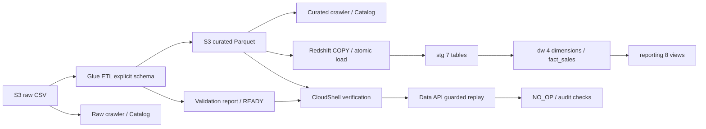

# ส่งมอบงาน Data Warehouse — 24 ตุลาคม 2026

เอกสารนี้เป็นทางเข้าอ่านงานล่าสุดสำหรับ Infra/BI และผู้รับช่วง งาน AWS ยืนยันจากผล query/log/ภาพที่ผู้ใช้ส่ง ไม่ใช่การตรวจบัญชีสดโดยผู้จัดทำเอกสาร

## ขอบเขตที่ส่งมอบ

Initial snapshot ของ TheLook: CSV7ตาราง → Glue cleaning/validation → Parquet → Redshift staging → 4dimensions + fact_sales → reporting8views พร้อม audit, retry/NO_OP และชุดทดสอบ SCD2/rollback

ผู้ใช้ตกลงใช้ Kaggle Version 1 ดาวน์โหลด 6 ตุลาคม 2026 เป็นข้อมูลคงที่สำหรับส่งงาน ตาม [หลักฐานต้นทางและ known issues](source_dataset_acceptance.md) จึงไม่รวม new-snapshot orchestration/schedule ในขอบเขตครั้งนี้ เวลา export/source snapshot และความครบถ้วนทุกแถวจาก BigQuery ยังไม่ทราบ การเลือกข้อมูลคงที่ไม่ใช่การยืนยัน known issues ของ DW/BI หรือการยืนยันสาเหตุจากต้นทาง

ตัวรัน CloudShell รวม S3 validation กับ Data API replay ได้แล้ว แต่ล็อกเฉพาะ batch ที่เผยแพร่สำเร็จ ไม่ใช่ pipeline รับ snapshot ใหม่ ไม่ใช่ scheduler และไม่ใช่ dashboard ที่ deploy แล้ว

## เริ่มอ่านและใช้งาน

1. อ่าน checklist [handoff1](handoff1.md) เพื่อแยกงาน DW/Infra/BI ที่เสร็จและค้าง
2. อ่าน [schema](data_warehouse_schema_design.md) และ [dictionary/cleaning](dataset_dictionary_and_cleaning.md)
3. อ่าน [BI handoff](bi_handoff.md) ก่อนใช้ reporting views; ผู้ใช้เลือกยอดแยกสถานะ ไม่เรียก net sales
4. อ่าน runbook เฉพาะงานก่อนรัน: [Glue ETL](glue_raw_to_curated_runbook.md), [warehouse package](glue_warehouse_package_runbook.md), [SCD tests](scd_rollback_test_runbook.md)
5. หากจะรับข้อมูลใหม่ อ่าน [new snapshot contract](new_snapshot_pipeline_contract.md) ก่อน ไม่มีเหตุให้ติดตั้ง schema/โหลด bootstrap ซ้ำเพียงเพื่อรับช่วงงาน

## ทรัพยากรและเส้นทาง

| รายการ | ค่าที่ใช้งาน |
|---|---|
| Account / region | 006816724683 / us-east-1 |
| Bucket | thelook-dwh-20241022 |
| Raw | s3://thelook-dwh-20241022/thelook/raw/initial-extract/ |
| Curated batch | thelook/curated/20261023T151247118967Z_f8a02155/ |
| Control report | thelook/control/20261023T151247118967Z_f8a02155/validation_report.json |
| Scripts / Spark logs / temp | thelook/scripts/ ; thelook/spark-history/ ; thelook/glue-temp/ |
| Cluster | thelook-redshift-cluster-1, provisioned ra3.large, 1 node, port5439, public off ตามหลักฐานก่อนหน้า |
| Database ที่ผ่าน full Glue batch / reporting | thelook_glue_validation |
| Synthetic test database | thelook_scd_test — ไม่ใช้เป็นข้อมูล BI |
| dev | ใช้ smoke/การทดลองเดิม ไม่ถือว่ามีสถานะเท่าฐาน validation |
| Role | arn:aws:iam::006816724683:role/LabRole |
| Secret reference | thelook/redshift — ไม่มี password/token ในเอกสาร |
| Glue connection | thelook-redshift-conn, JDBC เดิมชี้ /dev |
| Glue jobs | thelook-redshift-smoke-test; thelook-raw-to-curated |
| Glue ETL settings | Glue4, G.1X2, retry0, concurrency1, bookmark off; raw-to-curated timeout20นาที |
| Catalog | thelook_raw / thelook_curated; crawlers thelook-raw-crawler / thelook-curated-crawler |

**Network ต่างจากแผนเดิม:** cluster อยู่ default VPC vpc-0a0534d5310421fae; Glue JDBC อยู่ thelook-vpc vpc-03aaf81c62341e797 และเข้าผ่าน Redshift-managed endpoint vpce-0d6093443a00b58bc ชื่อ thelook-glue-redshift-endpoint

Glue subnet A: subnet-0c93df6636668db96; Glue SG sg-0045646501501b218; endpoint Redshift SG sg-0b074777ad7bd781a; Secrets endpoint SG sg-04bf4a8ceb28cd273; S3 gateway vpce-09c521c76d4613f00. Secrets endpoint ID ยังไม่มีหลักฐานบันทึก ต้องเก็บเพิ่ม ส่วน SG/endpoint policies และค่าใช้จ่ายจริงให้ Infra ตรวจสถานะปัจจุบัน

Catalog เป็น metadata branch; ETL ที่ทดสอบอ่าน S3 โดย explicit schema ยังไม่ได้อ่านผ่าน Catalog จึงไม่แสดงว่า Catalog เป็น input ที่บังคับใช้ใน ETL

## หลักฐานที่ผ่าน

| งาน | ผลยืนยัน |
|---|---|
| Glue connection/smoke | เชื่อมและอ่าน distribution centers10แถว |
| Raw → curated | 66checks PASS, quarantine0, PASS_WITH_KNOWN_ISSUES |
| Catalog | raw/curatedครบ7ตาราง, locations/header/typed curated schema ตรวจแล้ว |
| COPY | Parquet28parts; counts/PK/5money totals ผ่าน |
| Warehouse | ledger SUCCEEDED, fact181759; staging/warehouseเงินตรง |
| SCD/rollback/retry | attempts9: SUCCEEDED4/NO_OP1/FAILED4; ledger4; users7versions/current4 |
| Atomic handler patch | SHOW PROCEDUREไม่มี bare RAISE; before/after4ตาราง PASS |
| Manual replay | before/after8ตาราง PASS และ new_no_op_attempt PASS |
| CloudShell Data API runner | ผู้ใช้ยืนยัน REPLAY_PASSED: eight tables unchanged; one new NO_OP |
| Reporting | item_rows/grain/references/money/daily/product/DC/lineage8checks PASS บน AWS |

Package hash ของ batch จริง: d897e3ee9663b725c6a226b99712094cc5d536346c9577fe14a634e3cc2ac7d7

หลักฐาน raw exports/screenshots/Parquet/ZIP อยู่ outputs หรือที่ผู้ใช้เก็บ ไม่แนบ Git รายงานสรุปที่ review แล้วอยู่ [reporting acceptance](report/reporting_acceptance_20261024.md) การไม่พบไฟล์ outputs ใน clone ใหม่ไม่ได้หมายความว่าต้องรัน deployment ซ้ำ

### รายการหลักฐานสำหรับส่งต่อ

| กลุ่มหลักฐาน | รายงานสรุปที่อ่านใน repository ได้ | ไฟล์หลักฐานประกอบที่ผู้ดูแลต้องจัดส่ง/ระบุตำแหน่ง |
|---|---|---|
| ข้อมูลต้นทาง / S3 raw | [Source dataset acceptance](source_dataset_acceptance.md): 7 URI/ขนาด/เวลา/Versioning จากผลผู้ใช้ | ภาพ Kaggle/S3 และผล CloudShell ต้นฉบับ; ยังไม่รับรอง checksum S3 |
| Glue / Catalog / COPY / warehouse | หัวข้อหลักฐานที่ผ่านในเอกสารนี้ และ [handoff checklist](handoff1.md) | Glue run IDs/logs, Catalog/schema exports, validation report/READY, manifest/controls และผล ledger/count/money checks ของ batch จริง |
| SCD / rollback / retry / atomic patch | ตารางหลักฐานด้านบน และ [SCD runbook](scd_rollback_test_runbook.md) ซึ่งเป็นวิธีทดสอบ ไม่ใช่ผลทดสอบต้นฉบับ | ผล query/ภาพ before-after และ audit ของฐานทดสอบ รวมหลักฐาน patch ในฐาน validation |
| Guarded replay | สรุป REPLAY_PASSED ด้านบน | bundle ที่ใช้จริง, run UUID, result.json/statements.jsonl และผล before-after ของรอบที่ผ่าน |
| Reporting | [Reporting acceptance](report/reporting_acceptance_20261024.md): 8 checks และยอดแยกสถานะของ batch จริง | ภาพหรือ query exports ต้นฉบับที่ผู้ใช้เก็บ และ package ที่ใช้ติดตั้งหากจำเป็นสำหรับรับช่วง |

สถานะตารางนี้คือมีรายงานสรุปตามหลักฐานที่ผู้ใช้เคยส่ง แต่ยังไม่ได้ยืนยันการรวบรวม/จัดส่งไฟล์ต้นฉบับให้ผู้รับครบ การมีโฟลเดอร์ outputs ไม่เท่ากับตรวจว่าหลักฐานทุกชิ้นอยู่ครบ ให้ผู้ดูแลบันทึกตำแหน่งและผู้รับจริง โดยส่งข้อมูลจริง/outputs ผ่านช่องทางทีมแยกจาก Git และไม่แนบ credentials

รายงาน [curated local validation](report/curated_validation.md) และ [warehouse SQL local validation](report/warehouse_sql_local_validation.md) เป็นผล local batch `20261018T070120429459Z` ไม่ใช่หลักฐานของ AWS batch `20261023T151247118967Z_f8a02155` และไม่ใช้แทนผล AWS รอบจริง

## ส่งต่อและเจ้าของงานค้าง

| งาน | ผู้รับผิดชอบร่วม | เกณฑ์ปิด |
|---|---|---|
| Source metadata limitations | DW บันทึก; source owner ให้ข้อมูลหากมี | Version 1/ข้อมูลคงที่ตกลงแล้ว; เวลา snapshot และความครบถ้วนจาก BigQuery ยังไม่ทราบ ระบุเป็นข้อจำกัด ไม่สร้างเวลาแทน |
| Known issues acceptance | DW + BI | มีชื่อ/วันที่รับทราบ provisional-v1; ส่วนสาเหตุ city token/item timestamps ยังไม่ยืนยันโดยต้นทาง ไม่เปลี่ยน baselineเพื่อให้ผ่าน |
| Lifecycle/retention/encryption/policies | Infra + DW | ระบุ retentionแต่ละprefix/logs, owner, หลักฐานค่าจริงและสิทธิ์ที่จำเป็น |
| Read-only/RLS/BI connectivity | Infra + BI | ยืนยัน principal/สิทธิ์/เส้นทาง; ไม่ใช้ admin credentials เป็นการส่งมอบ |
| Dashboard acceptance | BI + DW | ยอด/filtersตรงviews, distinctordersไม่บวกข้ามกลุ่ม, labelsตรงmetricdictionary |
| New-snapshot orchestration/schedule | นอกขอบเขตครั้งนี้ | ไม่ได้ deploy; หากเปลี่ยนเป็นรับข้อมูลใหม่ ต้องมี source contract/negative tests/monitoring ก่อน |
| Budget/stop policy | Infra + ผู้ดูแลLab | ยอดจริง, ผู้รับผิดชอบและเวลาเปิด/พัก/เก็บ/ลบ |
| Monitoring/failure alerts | Infra + DW | ตกลงผู้ดูแล/ปลายทางและเก็บหลักฐานทดสอบ ไม่ถือว่า logs อย่างเดียวเป็น alert ที่ทดสอบแล้ว |
| ส่งมอบและรับมอบจริง | DW → Infra/BI | เอกสารพร้อมส่ง; รอการส่งจริง ชื่อผู้รับ วันที่ และผลรับมอบตามเอกสารต้นทาง |

ยังไม่รับรอง concurrency/cancellation/late-arriving acceptance; inventory stock metrics และ web funnel ต้องนิยามเพิ่ม ไม่ได้เสร็จจาก fact_sales

## ปฏิบัติงานและข้อควรระวัง

- ไม่ติดตั้ง DDL ซ้ำในฐานที่มีข้อมูล; ตรวจ current_database ทุกครั้ง
- ใช้ต้นฉบับ generator ใน code; แก้ SQL generated อย่างเดียวอาจถูกทับตอน build
- ห้ามใช้แพ็กเก่าที่มี bare RAISE; ใน atomic error handler; ต้องใช้รุ่นที่แก้แล้ว Default atomic modeบันทึกFAILEDแล้วส่งerrorเดิมกลับอัตโนมัติ
- Replay runner: verifyใช้ขณะclusterพักได้; runต้องAvailable; CloudShell venvติดตั้ง sqlparseโดยไม่ใช้ --user. เก็บ run UUID/result.json/statements.jsonl; timeoutที่ผลไม่แน่นอนต้องตรวจstatementก่อนretry
- รัน NO_OP เพิ่ม auditเป็นเรื่องปกติ อย่าคาดยอดattemptรวมเท่าภาพเก่าตลอดไป
- เก็บผลและไม่มีqueryค้างก่อนpause;สถานะclusterปัจจุบันต้องตรวจConsole เอกสารนี้ไม่อ้างว่าพักอยู่ตอนอ่าน
- observed_at anchor ของ bootstrap ไม่ใช่source-confirmed; processed_at/published_atไม่ใช้แทนเวลาsnapshot
- ไม่สร้าง NAT/CMK/custom roles เพิ่มเพื่อให้ครบchecklistโดยไม่มีความจำเป็น/สิทธิ์ที่ยืนยัน

## สถานะการรวบรวมหลักฐานล่าสุดสำหรับส่งต่อ

DW สำหรับ Version 1 แบบคงที่พร้อมส่งต่อ; การรับมอบและ known-issue acceptance ยังรอผู้รับยืนยัน รายการไฟล์จริงและข้อจำกัดอยู่ `outputs/DW-handoff-evidence/evidence_inventory.csv` และ README ของชุดหลักฐานในเครื่อง (ไม่แนบ Git)

- ได้รับ validation report66 PASS/quarantine0 และ READY ของ batch `20261023T151247118967Z_f8a02155`; ภาพ CloudWatch START/PASSED/OUTPUT ผูกกับ Run ID `jr_766afe9dd1daefe7e2c8bae1d39d8f9389167dfa338486247c28d65c853e9b4e`
- ได้รับภาพ current database/ledger SUCCEEDED และ checks7รายการ (PASS4/KNOWN_ISSUE3); staging/warehouse/reporting มี181759items,125226distinctorders,sale10827118.925100,cost5208355.223564; ยอด5สถานะตรงรายงานเดิม
- ได้รับภาพ SCD audit9attempts/4published batches/7user versions/4current users และ current-version violation0แถว เป็นสภาพปัจจุบัน ไม่ใช่ before/after ของ rollback
- ได้รับ replay result.json/statements.jsonl ของ run `ae45e3c1-e6e0-4d29-b70f-e63d3da1ea43`: REPLAY_PASSED,16statements FINISHED, comparison8ตาราง PASS,new_no_op_attempt PASS; package hashตรงที่ระบุในเอกสารนี้
- ยังขาดไฟล์ต้นฉบับ rollback before/after, atomic handler patch verification และภาพ/exports reporting checks8รายการรอบเดิม; Catalog schema/locationเต็มและCSV detailบางส่วนยังไม่มี รายงานสรุปเดิมไม่ใช่หลักฐานต้นฉบับที่รวบรวมครบแล้ว

ตารางรายการหลักฐานก่อนหน้าคือรายการที่ต้องส่ง ส่วนหัวข้อนี้ระบุสิ่งที่รวบรวมได้ล่าสุด ยังไม่มีการส่งภายนอกหรือรับมอบจริง และไม่ได้ตรวจ AWS สดโดยผู้จัดเอกสาร

## เพิ่มชั้น BI ตามฝ่าย — 25 ตุลาคม 2026

[SQL12](../code/sql/12_bi_role_views_final.sql) เพิ่ม schema bi8views (base1+สำหรับฝ่าย7), users/groups5ฝ่ายและGRANT; [คู่มือrole views](bi_role_views.md) อธิบายgrain/metrics/accessครบ นิยามBI net_salesตัด Cancelled/Returned:8127336.728623/netitems136437 เป็นยอดอ้างอิงจากstatusเดิม ไม่ใช่ผลexecuteSQL12ที่ผู้จัดเอกสารรัน และไม่ใช่recognized revenue

หัวSQLระบุdeployment/ยอด/สิทธิ์ผ่านแล้ว บันทึกเป็นสถานะตามผู้จัดทำSQL ยังไม่มีผลSQL12ต้นฉบับแนบในชุดหลักฐาน; ตัวอย่างpermission testingมีmarketing/sales ต้องตรวจครบ5กลุ่มและeffective privilegesก่อนรับรอง ไม่ใช่RLSหรือIAMroles และไม่ใช้เปลี่ยนสถานะDashboard/รับมอบ

viewsใหม่อ่านinventory/eventsจากstagingโดยตรง ต้องแยกจากfact_salesและตรวจsemantic/coverageของตัวเอง คู่มือเดิม/หลักฐานreporting8checksไม่รับรองSQL12อัตโนมัติ SQL12จัดส่งแยก ไม่ได้เพิ่มเข้าreporting generator/package และห้ามรันCREATE USER/GROUPซ้ำ
