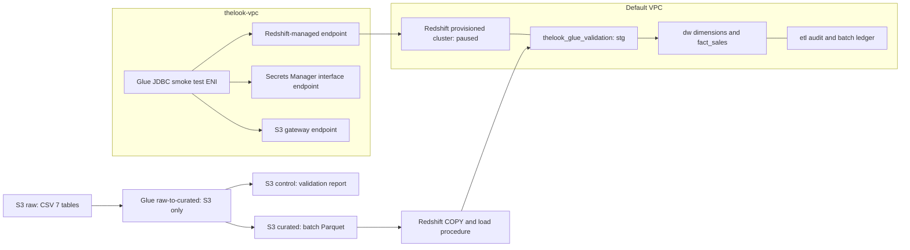

# DW status — 23 October 2026

> สถานะปัจจุบัน24ต.ค.2026 ดู [DW handoff](dw_handoff.md) และ checklist ล่าสุด เนื้อหาที่ระบุว่ายังไม่deploy/ทดสอบด้านล่างเป็นบันทึกหรือแผนเดิม ไม่ใช่สถานะปัจจุบัน ห้ามรันขั้นติดตั้งซ้ำบนฐานที่มีข้อมูล

หลักฐาน: ผล Console/SQL ที่ผู้ใช้ส่ง, validation_report และ package ที่เก็บใน workspace ไม่ใช่การสำรวจ AWS live โดย agent

## ผ่านแล้ว

เพิ่มผล manual replay: ผู้ใช้ส่งภาพ8ตาราง unchanged PASS, new_no_op_attempt PASS และ audit NO_OP ใหม่ (2026-10-23 18:44:46 UTC) ยืนยันขั้น manual replay ผ่าน เตรียม `outputs/aws/validation-replay-runner.zip` เพื่อรวม S3 gate กับ Data API execution ในหนึ่งคำสั่งแบบ manual; local mocked session/failure/PASS-result tests3ผ่าน ยังไม่ได้ยืนยันสิทธิ์ Data API หรือ execute runner บน AWS

เพิ่มผล 24 ต.ค.: ผู้ใช้ส่ง SHOW PROCEDURE ยืนยัน validation loader ไม่มี bare RAISE ใน atomic exception handler แล้ว และผลเทียบก่อน–หลัง patch ของ dim_users/fact_sales/batch_ledger/batch_attempts เป็น PASS ทั้ง4ตาราง เตรียม `outputs/aws/validation-replay-kit.zip` สำหรับ read-only S3 gate และสร้าง guarded NO_OP SQL; ยังไม่รันชุด replay นี้บน AWS และยังไม่ใช่ automated orchestration

เพิ่มผล 24 ต.ค. (เวลาไทย): raw crawler READY / SUCCEEDED, 7 ตารางชื่อ *_csv, location ชี้ CSV ถูกไฟล์, ไม่มี partition keys; ตรวจชื่อและลำดับ columns เทียบ header ใน dataset/*.csv ผ่านครบ 7 ตาราง เก็บหลักฐาน outputs/aws/catalog-review/catalog_raw_status.json. Raw inferred types เช่น money double / timestamps string ไม่ใช่ curated contract จึงไม่เปลี่ยน ETL ตาม raw inference ขั้นถัดไปเตรียม baseline gate ใน docs/scd_rollback_test_runbook.md; SCD/rollback ยังไม่ได้รัน

เพิ่มผล curated Catalog: crawler `thelook-curated-crawler` SUCCEEDED (StartTime 2026-10-23 16:53:43 UTC), READY, 7 ตาราง ตรวจชื่อ/ลำดับ/ชนิด columns เทียบ curated_schema.json รวม derived columns ใน Glue script แล้วตรงทุกตาราง; locations ตรง batch ที่ระบุ, classification parquet และไม่มี partition keys ทั้งหมด หลักฐานที่ผู้ใช้ส่งเก็บใน `outputs/aws/catalog-review/catalog_curated_status.json` เป็นการตรวจ metadata ไม่ใช่การนับข้อมูลใหม่ Raw Catalog ยังรอทำ

| งาน | หลักฐาน / ขอบเขต |
|---|---|
| Raw บน S3 | CSV 7 ตาราง ที่ `s3://thelook-dwh-20241022/thelook/raw/initial-extract/` |
| Connection / smoke test | `thelook-redshift-conn`; อ่าน distribution centers 10 แถว |
| Glue ETL | `thelook-raw-to-curated`, Glue 4.0, G.1X 2 workers; report 66 checks PASS, quarantine 0, PASS_WITH_KNOWN_ISSUES |
| Parquet COPY | 28 parts / 7 tables, counts / PK / 5 money totals ผ่าน |
| Warehouse bootstrap | database `thelook_glue_validation`, batch `20261023T151247118967Z_f8a02155`; ledger SUCCEEDED |
| Reconciliation | staging และ fact_sales 181,759 แถว; sale_price 10,827,118.925100 ตรงกัน |
| รัน batch เดิมซ้ำ | NO_OP; snapshot comparison 8 ตาราง PASS; new_no_op_attempt PASS |
| พัก cluster | ผู้ใช้แจ้งว่าพัก `thelook-redshift-cluster-1` แล้ว |

8 ตารางที่เปรียบเทียบ NO_OP: dw.dim_users, dw.dim_date, dw.dim_products, dw.dim_distribution_centers, dw.fact_sales, etl.batch_ledger, etl.batch_inputs, etl.batch_checks ไม่รวม staging

Counts: distribution_centers 10, products 29,120, users 100,000, orders 125,226, order_items 181,759, inventory_items 490,705, events 2,431,963

Package hash: `d897e3ee9663b725c6a226b99712094cc5d536346c9577fe14a634e3cc2ac7d7`

## Architecture ที่ใช้งานแล้ว

Region us-east-1, account 006816724683, runtime LabRole. Infra VPC `vpc-03aaf81c62341e797`; cluster default VPC `vpc-0a0534d5310421fae`. Managed endpoint `vpce-0d6093443a00b58bc`; S3 gateway `vpce-09c521c76d4613f00`. Secrets endpoint ID ยังไม่ได้เก็บหลักฐาน จึงไม่ระบุเดา

JDBC connection เดิมชี้ `/dev`; full package ใช้ `thelook_glue_validation` ต้องกำหนด database ให้ชัดก่อนเตรียม automated loader ห้ามถือว่าทั้งสอง DB มีสถานะเดียวกัน

## ลำดับงานต่อไป / acceptance

1. **Catalog:** สร้าง raw/curated databases และ crawlers ตาม [runbook](glue_catalog_runbook.md); ตรวจ 7 ตารางต่อ database, location, columns และ curated types เก็บผล export ก่อนถือว่าผ่าน
2. **SCD2 และ rollback:** เตรียม fixture แยกจาก batch จริงใน test DB; ทดสอบ user เปลี่ยน attribute, user ใหม่, NULL transition, replay, bad FK/duplicate/money mismatch และ rollback ต้องไม่เปลี่ยน DW เดิม ขณะนี้ยังไม่ได้ทดสอบชุดนี้
3. **Orchestration:** เชื่อม ETL → report/READY gate → package verification → persistent-session load → reconciliation; แยก processed_at จาก source_observed_at; ทดสอบ failed/retry ก่อนเปิด schedule
4. **Monitoring / handoff Infra:** เก็บ endpoint ID, role/policy ที่ใช้งาน, alarm/retention, ค่าใช้จ่ายจริง และขั้น resume/pause; หลีกเลี่ยงสร้าง NAT/CMK/custom roles เพิ่มเพียงเพราะอยู่ในแผนเดิม
5. **Reporting / BI:** ตกลง grain, status ของยอดขาย, returns/cancellations และ timezone แล้วทำ SQL/views + dictionary; inventory/events เป็น staging แล้ว แต่ยังไม่มี fact เฉพาะสองเรื่องนี้ QuickSight ยังไม่ได้ยืนยันสิทธิ์ใช้งาน

Catalog ที่จะสร้างเป็น metadata; ETL ที่ผ่านแล้วอ่าน S3 โดยใช้ schema contract ในโค้ด ยังไม่ได้อ่านผ่าน Catalog ให้ระบุเช่นนี้ใน diagram/report จนกว่าจะเพิ่มการเชื่อมจริงและทดสอบ

## ข้อจำกัดที่ต้องส่งต่อ

- กฎ provisional-v1: users city NULL 958, events city NULL 23,080, shipped-before-created 35,872 ยังรอยืนยันกับต้นทาง
- source_observed_at ยัง null; package ใช้ anchor จาก batch เดิมของ raw snapshot เดียวกันเพื่อ isolated bootstrap เท่านั้น ห้ามใช้ processing time เป็น observation time ของ incremental production โดยอัตโนมัติ
- SUM sale_price ทุกสถานะเป็นยอด reconciliation ไม่ใช่ recognized revenue หรือ net sales
- หลักฐานสำเร็จยังไม่ครอบคลุม SCD change, rollback injection, concurrent runs หรือ BI acceptance
- Cluster paused ไม่ได้หมายความว่าทรัพยากร S3/storage/interface endpoints ไม่มีค่าใช้จ่าย
